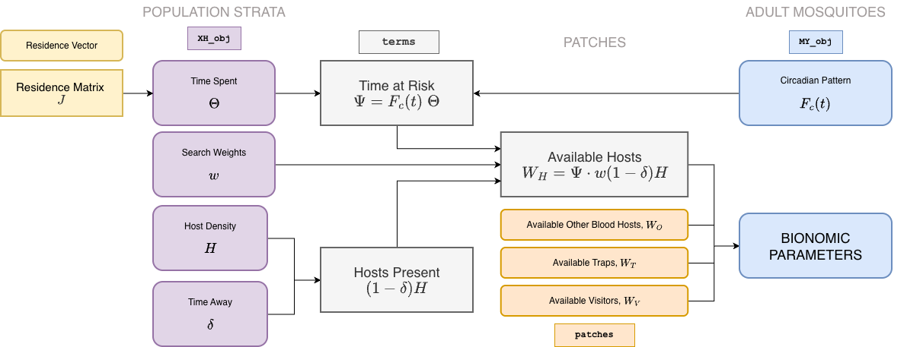

# Blood Feeding

In **`ramp.xds`**, blood feeding is understood as an interaction between
mosquitoes and humans. An interface was designed to model blood feeding
in a way that was mathematically sound. For most **MY** modules, the
default setup option passes the values of bionomic parameters, making it
possible to build models that are not mathematically sound. Three
potential issues are:

- \\f\\ is positive when no blood hosts are present;

- \\q \neq 0\\ when no humans are present; or

- \\q \neq 1\\ when only humans are present.

To handle these issues and ensure that blood feeding and transmission
are consistent, an interface was developed to compute mosquito bionomic
parameters in relation to resource availability. This was also used to
develop the [Transmission
Interface](https://dd-harp.github.io/ramp.xds/articles/Transmission.md).

------------------------------------------------------------------------



------------------------------------------------------------------------

``` r

library(ramp.xds)
```

The human population is segmented into strata by residency: the patch
where each stratum resides is passed as a vector called `residence`.
Information about residency is passed in a vector during basic setup,
and `nStrata = length(residence)`. The residence matrix, \\J\\, is used
to do sums by patch using a dot product. It gets created from the
residence vector and the number of patches:

``` r

residence = c(1,1, 2, 2)
make_residence_matrix(3, residence) -> J
J
```

    ##      [,1] [,2] [,3] [,4]
    ## [1,]    1    1    0    0
    ## [2,]    0    0    1    1
    ## [3,]    0    0    0    0

The user also passes human population density \\H.\\ The total resident
population of each patch is computed as follows:

``` r

H = c(1000, 100, 100, 10)
J %*% H
```

    ##      [,1]
    ## [1,] 1100
    ## [2,]  110
    ## [3,]    0

## Available Humans

The model for blood feeding is motivated by a simple concept of
**availability**: mosquitoes search for humans; the humans are found in
places where they spend time when mosquitoes are active. Availability is
based on a measure of weighted, ambient population.

**Humans** spend time.

- \\H\\ — Human population density.

- \\w\\ — Each human population stratum has a **search weight**. These
  are one measure of how easy it is for a mosquito to find a human and
  blood feed. They are also used to model *heterogeneous biting.*

  - During basic setup, the search weights are set to 1 by default for
    all strata

  - The search weights can be modified using
    `setup_blood_search_weights`

- \\\delta\\ — Humans sometimes *travel.* In this model, it means they
  spend some time outside the *spatial domain* that is represented by
  the patches.

  - By default, time away for all the strata is set to 0.

  - Time away can be changed by `setup_time_away`

  - The density of humans who are present, or not traveling, is
    \\(1-\delta)H\\

- \\\Theta\\ — A matrix that describes how humans spend their time.
  There is one column for each stratum. Each column should sum to a
  number that is less than or equal to one. If the column does not sum
  to 1, then humans are spending some time *not at risk* when they are
  not traveling.

  - During basic setup, the time spent is initialized to be the same as
    the residence matrix.

  - Models for time spent are set up by `setup_timespent`

**Ambient Population Density** (not residency) is the average population
density in the patches: \\A = \Theta \cdot (1-\delta) H \\

**Mosquitoes** search for blood hosts, and there is a daily activity
pattern.

- The daily mosquito activity pattern is described by a circadian
  function \\F_c(t).\\ Its average over a one-day interval should be
  approximately one: \\\int_t^{t+1} F_c(s) ds \approx 1\\

  - During setup, mosquitoes are equally active at all times of day.

  - An alternative circadian function can be set up using
    `setup_F_circadian`

**Time at Risk** is the product of time spent and the relative rate of
mosquito blood feeding evaluated at simulation time \\t\\: \\\Psi =
F_c(t) \Theta\\

**Availability** is a measure of population density weighted by search
weights, time at risk, and the fraction of time not traveling: \\W_H =
\Psi \cdot w H \left(1-\delta\right)\\

Products of stratum vectors, such as \\wH(1-\delta)\\, are element-wise;
multiplication by \\\Theta\\ or \\\Psi\\ is a matrix-vector product.

## Other Blood

Mosquitoes searching for blood hosts can often find something that isn’t
a resident human:

- \\W_O\\ — Other blood hosts

  - The availability of other blood hosts is set to 0.

  - Other values can be configured using `setup_other_blood_hosts`

- \\W_T\\ — Traps that capture blood feeding mosquitoes

  - The availability of blood traps is set to 0.

  - Other values can be configured using `setup_blood_traps`

- \\W_V\\ — Human visitors or non-resident humans

  - The availability of visitors is set to 0.

  - Other values can be configured using `setup_visitors`

The total availability of all resources that would attract blood feeding
mosquitoes is \\B= W_H + W_O + W_T + W_V\\

The fraction of bites on resident humans is: \\\frac{W_H}{B}\\

## Bionomics

Users can set up resources to motivate heterogeneous mosquito behaviors
in a way that guarantees there are no mathematical inconsistencies like
the ones listed at the top of this document. This also frames mosquito
bionomics in terms of *resource ecology.*

The mosquito bionomic parameters describing **blood feeding** — blood
feeding rates \\f\\, the human fraction \\q\\, and possibly emigration
rates, \\\sigma\\ — can be computed as a function of available
resources. We call these *functional responses.*

- The blood feeding rate is a function of the total available blood \\f
  = F_f(B, ...)\\

- The human fraction is \\q = F_q(t, W_V(t), W_H(t), B(t))=
  \frac{W_V+W_H}{B}\\

- Emigration is a result of searching for resources, including blood:
  \\\sigma = F\_\sigma(t, B(t),...)\\

------------------------------------------------------------------------
