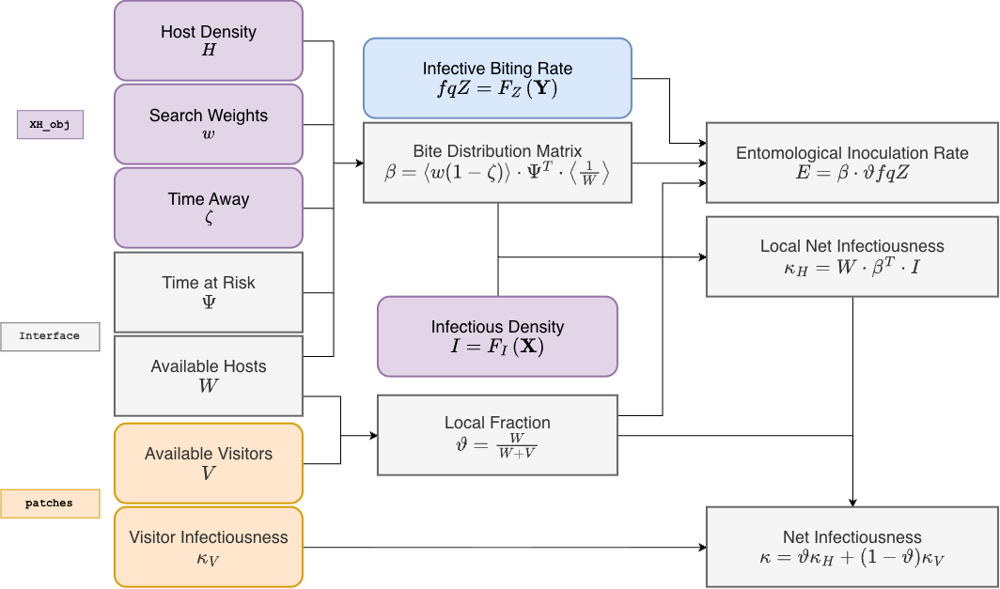

# Transmission

The transmission interface was developed to compute two terms:

- the daily local entomological inoculation rate (EIR), the number of
  infective bites, per person in each stratum, per day from exposure
  within the modeled patches. Note that the daily force of infection
  (FoI) is computed using the [exposure
  interface](https://dd-harp.github.io/ramp.xds/articles/Exposure.md),
  which can also use information about travel malaria, environmental
  heterogeneity, and pre-erythrocytic immunity.

- the net infectiousness (\\\kappa\\), the probability a mosquito would
  become infected after blood feeding on a human.

To compute these terms, the *bite distribution matrix* (\\\beta\\) is
constructed. It allocates bites in each patch per member of each
population stratum, accounting for the fraction of time spent not
traveling. In a model with one patch and one stratum and positive host
availability, \\\beta = 1/H.\\ The matrix uses *human availability* and
time at risk to allocate bites in patches to humans in strata.

By design, it uses the same quantities that were defined in the [blood
feeding
interface](https://dd-harp.github.io/ramp.xds/articles/BloodFeeding.md).

------------------------------------------------------------------------

------------------------------------------------------------------------

**Computation**

- \\\beta\\ — The bite distribution matrix, \\\beta\\, allocates bites
  per member of each population stratum, accounting for absence while
  traveling. The infective biting density per unit of local host
  availability in each patch is \\fqZ/W.\\ In the formula, angle
  brackets denote a diagonal matrix. Bites are allocated using search
  weights, time at risk, and the fraction of time not traveling.

  - The vector of local host availability, \\W,\\ has length `nPatches`
    and is computed as part of [Blood
    Feeding](https://dd-harp.github.io/ramp.xds/articles/BloodFeeding.md).

  - The density of residents who are not traveling is \\(1-\zeta) H\\.

  - The function that computes \\\beta\\ replaces zero entries of \\W\\
    with one before dividing, to avoid division-by-zero errors.

- \\\vartheta\\ — Bites are allocated by availability. The availability
  of visitors in each patch \\V\\ is a variable that can be set by
  [setup_visitors](https://dd-harp.github.io/ramp.xds/reference/setup_visitors.html).
  If \\W+V=0\\, the implementation sets the local fraction to one by
  convention.

The bite distribution matrix is:

\\\beta = \left\<w (1-\zeta)\right\> \cdot \Psi^T \cdot \left\<
\frac{1}W \right\> \\

**The EIR**

- \\fqZ\\ — The net infective human biting rate, \\fqZ,\\ is the number
  of infective bites on humans by adult mosquitoes in each patch, per
  day. A fraction of these, \\\vartheta\\, are on available humans
  \\(W)\\ as opposed to visitors \\(V).\\ This is one of the dynamical
  terms computed from the state space describing infected mosquitoes
  (**Y**) by a function (denoted \\F_Z\\ and called `F_fqZ`) supplied by
  each **MY** module.

- \\E\\ — The EIR is computed by taking the product of the local
  fraction and net infective human biting rate and the mixing matrix.

The EIR is \\ \beta \cdot \vartheta (fqZ)\\

The product \\\vartheta(fqZ)\\ is element-wise; multiplication by
\\\beta\\ is a matrix-vector product.

**Net Infectiousness**

The fraction of mosquitoes that get infected after blood feeding on a
human in each patch is called *net infectiousness.* It uses the bite
distribution to average infectiousness by availability for all humans
present.

- \\I\\ — A function \\F_I\\ supplied by each **XH** component computes
  the infectious density of each stratum: the probability a mosquito
  would be infected after biting a member of each stratum is \\I/H\\.

- \\\kappa_H\\ — Using the transpose of \\\beta,\\ biting on humans is
  averaged by availability at the patch level. This gives the net
  infectiousness of the resident population, the probability a mosquito
  would become infected after blood feeding on a resident human in the
  patch.

- \\\kappa_V\\ — The infectiousness of visitors is a variable that can
  be set up by
  [setup_vis_kappa](https://dd-harp.github.io/ramp.xds/reference/setup_vis_kappa.html).

Net infectiousness is \\ \vartheta \kappa_H + (1-\vartheta) \kappa_V\\
