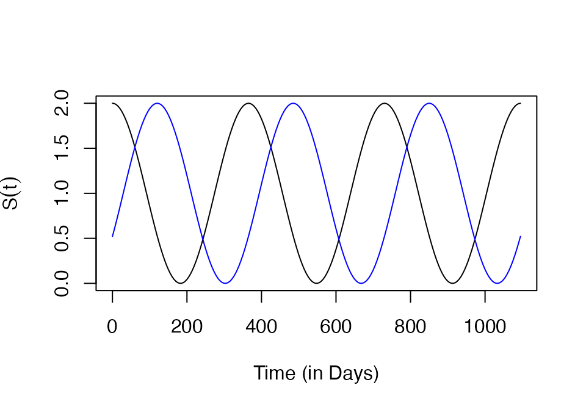
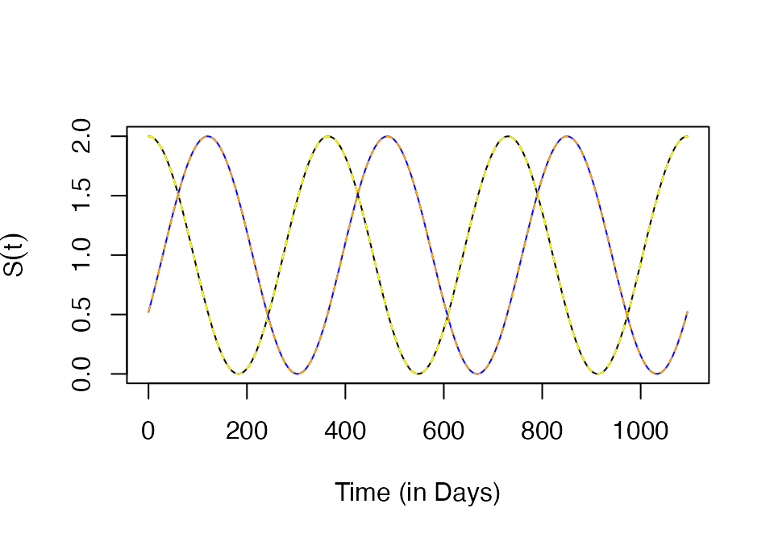
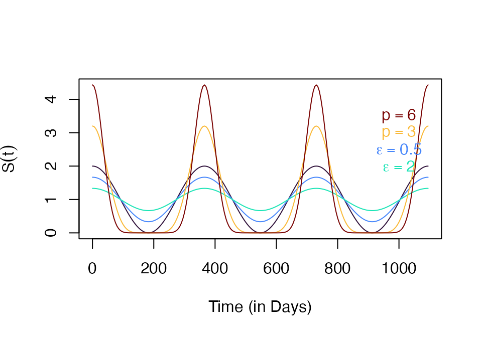

# Trace Functions

\
[`library`](https://rdrr.io/r/base/library.html)`(`[`ramp.xds`](https://dd-harp.github.io/ramp.xds/)`)`\
[`library`](https://rdrr.io/r/base/library.html)`(`[`viridisLite`](https://sjmgarnier.github.io/viridisLite/)`)`

As part of the *plug-and-play* modular design for **`ramp.xds`,** each
dynamical component includes a trivial model that has no variables. The
outputs required by other components are passed as a **trace function**.
Trace functions in **`ramp.xds`** have three parts:

- a mean value, and/or a scaling argument

- a function that returns a F_seasonal signal, configured with a line in
  the appropriate options list, `F_season = function(t){...}`

- a function that returns a F_trend, configured with a line in the
  appropriate options list, `F_trend = function(t){...}`

A trace function can be configured in two ways:

- A function can be passed as an argument;

- Parameters to configure a function using `make_function` can be
  passed; by default the parameter option is set to `NULL,` and if not
  null, then `make_function` gets called and the parameters are saved.

## Trivial Modules

The trivial modules each returns different values:

- The trivial **L**-component module is set up by `create_Lpar_trivial.`
  The function
  [`F_emerge()`](https://dd-harp.github.io/ramp.xds/reference/F_emerge.md)
  returns `Lambda*F_season(t)*F_trend(t).` To override the defaults,
  `Lopts` must be a named list that sets the values of the elements:

  - `Lambda = c(...)` is the

  - `F_season = function(t){...}`

  - `F_trend = function(t){...}`

- The trivial **MYZ**-component module is setup by
  `make_MYZpar_trivial.` The values will return either `F_fqZ` or
  `F_eggs`

  - Both `F_fqZ` and `F_eggs` use the same seasonality and trend
    functions:

    - `F_season = function(t){...}`

    - `F_trend = function(t){...}`

  - the function
    [`F_fqZ()`](https://dd-harp.github.io/ramp.xds/reference/F_fqZ.md)
    returns `f*q*Z*F_season(t)*F_trend(t)`. To configure, `MYZopts`
    should be a named list that sets the values of the elements:

    - `f = c(...)`

    - `q = c(...)`

    - `Z = c(...)`

  - the function
    [`F_eggs()`](https://dd-harp.github.io/ramp.xds/reference/F_eggs.md)
    returns `eggs*F_season(t)*F_trend(t)`; to override the defaults,
    `MYZopts` must be a named list that sets the values of the elements:

    - `eggs = c(...)`

- The trivial **X**-component module for human / host infection and
  immunity is set up by `create_Xpar_trivial.` `F_X` calls `F_H` and
  then returns `H*kappa*F_season(t)*F_trend(t)`

  - `F_H` is configured in `xds_setup` by passing `HPop = ...`

  - To configure `F_X,` `Xopts` must be a named list that sets the
    values of the elements. The values of `F_X` should be in the
    interval \\(\[0,H\]:\\)

    - `kappa = c(...)`

    - `F_season = function(t){...}`

    - `F_trend = function(t){...}`

## `make_function`

To make it easy to conduct thought experiments, **`ramp.xds`** has
developed a system for setting up functions:

- `make_function(opts)` as a tool for generating functions with the
  right properties.

- `makepar_F_*` is an informal function family to construct parameter /
  options for `make_function` methods.

### Seasonality

A constructor for seasonality functions drawn from a generalized family
involving trigonometric functions is returned by `make_function.sin`
with the associated `makepar_F_sin` that returns functions of the form:
\\\[S(t) = c\left(1 + \epsilon + \sin\left(\frac{2 \pi
(t-\tau)}{365}\right)\right)^p\\\]

- \\(c\\) or `norm` is a normalizing constant

- \\(\tau\\) or `phase` sets the timing of the peak

- \\(\epsilon \geq 0\\) or `bottom` is a shape parameter: increasing the
  values of \\(\epsilon\\) reduces the variance

- \\(p \geq 0\\) or `pw` is a shape parameter.

\
`p1`` ``=`` `[`makepar_F_sin`](https://dd-harp.github.io/ramp.xds/reference/makepar_F_sin.md)`(``)`\
`S1`` ``<-`` `[`make_function`](https://dd-harp.github.io/ramp.xds/reference/make_function.md)`(``p1``)`

The default normalizing constant is \\(365\\) so that if \\(S\\) is
multiplied by some other constant, \\(m,\\) the average daily value of
the function over a year is \\(1.\\)

\
[`integrate`](https://rdrr.io/r/stats/integrate.html)`(``S1``, ``0``, ``365``)``$``val`

    ## [1] 365

\
`tt`` ``<-`` `[`seq`](https://rdrr.io/r/base/seq.html)`(``0``, ``3``*``365``, by``=``5``)`\
[`plot`](https://rdrr.io/r/graphics/plot.default.html)`(``tt``, ``S1``(``tt``)``, type ``=``"l"``, xlab ``=`` ``"Time (in Days)"``, ylab ``=`` `[`expression`](https://rdrr.io/r/base/expression.html)`(``S``(``t``)``)``)`

\
`p2`` ``=`` `[`makepar_F_sin`](https://dd-harp.github.io/ramp.xds/reference/makepar_F_sin.md)`(``phase``=``120``)`\
`S2`` ``<-`` `[`make_function`](https://dd-harp.github.io/ramp.xds/reference/make_function.md)`(``p2``)`

\
[`plot`](https://rdrr.io/r/graphics/plot.default.html)`(``tt``, ``S1``(``tt``)``, type ``=``"l"``, xlab ``=`` ``"Time (in Days)"``, ylab ``=`` `[`expression`](https://rdrr.io/r/base/expression.html)`(``S``(``t``)``)``)`\
[`lines`](https://rdrr.io/r/graphics/lines.html)`(``tt``, ``S2``(``tt``)``, col ``=`` ``"blue"``)`

The function can return a vector of \\(N\\) functions, each one
configured as if \\(N=1\\)

\
`p3`` ``=`` `[`makepar_F_sin`](https://dd-harp.github.io/ramp.xds/reference/makepar_F_sin.md)`(``phase ``=`` `[`c`](https://rdrr.io/r/base/c.html)`(``0``,``120``)``, N``=``2``)`\
`S3`` ``<-`` `[`make_function`](https://dd-harp.github.io/ramp.xds/reference/make_function.md)`(``p3``)`

\
`s3`` ``<-`` ``S3``(``tt``)`` `\
[`plot`](https://rdrr.io/r/graphics/plot.default.html)`(``tt``, ``s3``[``1``,``]``, type ``=``"l"``, xlab ``=`` ``"Time (in Days)"``, ylab ``=`` `[`expression`](https://rdrr.io/r/base/expression.html)`(``S``(``t``)``)``)`\
[`lines`](https://rdrr.io/r/graphics/lines.html)`(``tt``, ``S1``(``tt``)``, col ``=`` ``"yellow"``, lty``=``2``)`\
[`lines`](https://rdrr.io/r/graphics/lines.html)`(``tt``, ``s3``[``2``,``]``, col ``=`` ``"blue"``)`\
[`lines`](https://rdrr.io/r/graphics/lines.html)`(``tt``, ``S2``(``tt``)``, col ``=`` ``"orange"``, lty``=``2``)`

\
`p4`` ``<-`` `[`makepar_F_sin`](https://dd-harp.github.io/ramp.xds/reference/makepar_F_sin.md)`(``bottom``=``.5``)`\
`p5`` ``<-`` `[`makepar_F_sin`](https://dd-harp.github.io/ramp.xds/reference/makepar_F_sin.md)`(``bottom``=``2``)`\
`p6`` ``<-`` `[`makepar_F_sin`](https://dd-harp.github.io/ramp.xds/reference/makepar_F_sin.md)`(``pw``=``3``)`\
`p7`` ``<-`` `[`makepar_F_sin`](https://dd-harp.github.io/ramp.xds/reference/makepar_F_sin.md)`(``pw``=``6``)`

\
`S4`` ``<-`` `[`make_function`](https://dd-harp.github.io/ramp.xds/reference/make_function.md)`(``p4``)`\
`S5`` ``<-`` `[`make_function`](https://dd-harp.github.io/ramp.xds/reference/make_function.md)`(``p5``)`\
`S6`` ``<-`` `[`make_function`](https://dd-harp.github.io/ramp.xds/reference/make_function.md)`(``p6``)`\
`S7`` ``<-`` `[`make_function`](https://dd-harp.github.io/ramp.xds/reference/make_function.md)`(``p7``)`

The shape parameters make it easy to configure a seasonality function
with a range of features:

\
`clrs`` ``=`` `[`turbo`](https://sjmgarnier.github.io/viridisLite/reference/viridis.html)`(``7``)`\
[`plot`](https://rdrr.io/r/graphics/plot.default.html)`(``tt``, ``S7``(``tt``)``, type ``=``"n"``, xlab ``=`` ``"Time (in Days)"``, ylab ``=`` `[`expression`](https://rdrr.io/r/base/expression.html)`(``S``(``t``)``)``)`\
[`lines`](https://rdrr.io/r/graphics/lines.html)`(``tt``, ``S1``(``tt``)``, col ``=`` ``clrs``[``1``]``)`\
[`lines`](https://rdrr.io/r/graphics/lines.html)`(``tt``, ``S4``(``tt``)``, col ``=`` ``clrs``[``2``]``)`\
[`lines`](https://rdrr.io/r/graphics/lines.html)`(``tt``, ``S5``(``tt``)``, col ``=`` ``clrs``[``3``]``)`\
[`lines`](https://rdrr.io/r/graphics/lines.html)`(``tt``, ``S6``(``tt``)``, col ``=`` ``clrs``[``5``]``)`\
[`lines`](https://rdrr.io/r/graphics/lines.html)`(``tt``, ``S7``(``tt``)``, col ``=`` ``clrs``[``7``]``)`\
[`text`](https://rdrr.io/r/graphics/text.html)`(``1000``, ``3.5``, `[`expression`](https://rdrr.io/r/base/expression.html)`(``p``==``6``)``, col``=``clrs``[``7``]``)`\
[`text`](https://rdrr.io/r/graphics/text.html)`(``1000``, ``3``, `[`expression`](https://rdrr.io/r/base/expression.html)`(``p``==``3``)``, col``=``clrs``[``5``]``)`\
[`text`](https://rdrr.io/r/graphics/text.html)`(``1000``, ``2.5``, `[`expression`](https://rdrr.io/r/base/expression.html)`(``epsilon``==``0.5``)``, col``=``clrs``[``2``]``)`\
[`text`](https://rdrr.io/r/graphics/text.html)`(``1000``, ``2``, `[`expression`](https://rdrr.io/r/base/expression.html)`(``epsilon``==``2``)``, col``=``clrs``[``3``]``)`

### `sigmoid`

\
`ps1`` ``<-`` `[`makepar_F_sigmoid`](https://dd-harp.github.io/ramp.xds/reference/makepar_F_sigmoid.md)`(``)`\
`Fs1`` ``<-`` `[`make_function`](https://dd-harp.github.io/ramp.xds/reference/make_function.md)`(``ps1``)`

\
`tt`` ``<-`` `[`seq`](https://rdrr.io/r/base/seq.html)`(``0``, ``365``, by``=``5``)`\
[`plot`](https://rdrr.io/r/graphics/plot.default.html)`(``tt``, ``Fs1``(``tt``)``, type ``=``"l"``, xlab ``=`` ``"Time (in Days)"``, ylab ``=`` `[`expression`](https://rdrr.io/r/base/expression.html)`(``Fs1``(``t``)``)``)`

### `sharkfin`

\
`c1`` ``<-`` `[`makepar_F_sharkfin`](https://dd-harp.github.io/ramp.xds/reference/makepar_F_sharkfin.md)`(``)`\
`C1``<-`` `[`make_function`](https://dd-harp.github.io/ramp.xds/reference/make_function.md)`(``c1``)`

\
`tt`` ``<-`` `[`seq`](https://rdrr.io/r/base/seq.html)`(``0``, ``565``, by``=``5``)`\
[`plot`](https://rdrr.io/r/graphics/plot.default.html)`(``tt``, ``C1``(``tt``)``, type ``=``"l"``, xlab ``=`` ``"Time (in Days)"``, ylab ``=`` `[`expression`](https://rdrr.io/r/base/expression.html)`(``Fs1``(``t``)``)``)`

\
`c2a`` ``<-`` `[`makepar_F_sharkfin`](https://dd-harp.github.io/ramp.xds/reference/makepar_F_sharkfin.md)`(``L ``=`` ``90``, dk ``=`` ``1``/``110``)`\
`c2b`` ``<-`` `[`makepar_F_sharkfin`](https://dd-harp.github.io/ramp.xds/reference/makepar_F_sharkfin.md)`(``L ``=`` ``180``, dk ``=`` ``1``/``40``)`

\
`c2`` ``<-`` `[`makepar_F_sharkfin`](https://dd-harp.github.io/ramp.xds/reference/makepar_F_sharkfin.md)`(``L ``=`` `[`c`](https://rdrr.io/r/base/c.html)`(``90``, ``180``)``, dk ``=`` `[`c`](https://rdrr.io/r/base/c.html)`(``1``/``110``, ``1``/``40``)``, pw``=`[`c`](https://rdrr.io/r/base/c.html)`(``2``,``1``)``, N``=``2``)`

\
`C2``<-`` `[`make_function`](https://dd-harp.github.io/ramp.xds/reference/make_function.md)`(``c2``)`

\
`C2t`` ``<-`` ``C2``(``tt``)`

\
[`plot`](https://rdrr.io/r/graphics/plot.default.html)`(``tt``, ``C2t``[``1``,``]``, type ``=``"l"``, xlab ``=`` ``"Time (in Days)"``, ylab ``=`` `[`expression`](https://rdrr.io/r/base/expression.html)`(``Fs1``(``t``)``)``)`\
[`lines`](https://rdrr.io/r/graphics/lines.html)`(``tt``, ``C2t``[``2``,``]``)`

### Spline

\
`tv`` ``=`` `[`c`](https://rdrr.io/r/base/c.html)`(``-``1``:``6``)``*``365``/``4`\
`yv`` ``=`` `[`c`](https://rdrr.io/r/base/c.html)`(``1``/``2``, ``1``, ``2``, ``1``, ``1``/``3``, ``1``, ``3``, ``1``)`` `\
`sp0`` ``<-`` `[`makepar_F_spline`](https://dd-harp.github.io/ramp.xds/reference/makepar_F_spline.md)`(``tv``, ``yv``)`

\
`ff`` ``<-`` `[`make_function`](https://dd-harp.github.io/ramp.xds/reference/make_function.md)`(``sp0``)`

\
[`plot`](https://rdrr.io/r/graphics/plot.default.html)`(``tt``, ``ff``(``tt``)``, type ``=`` ``"l"``)`

