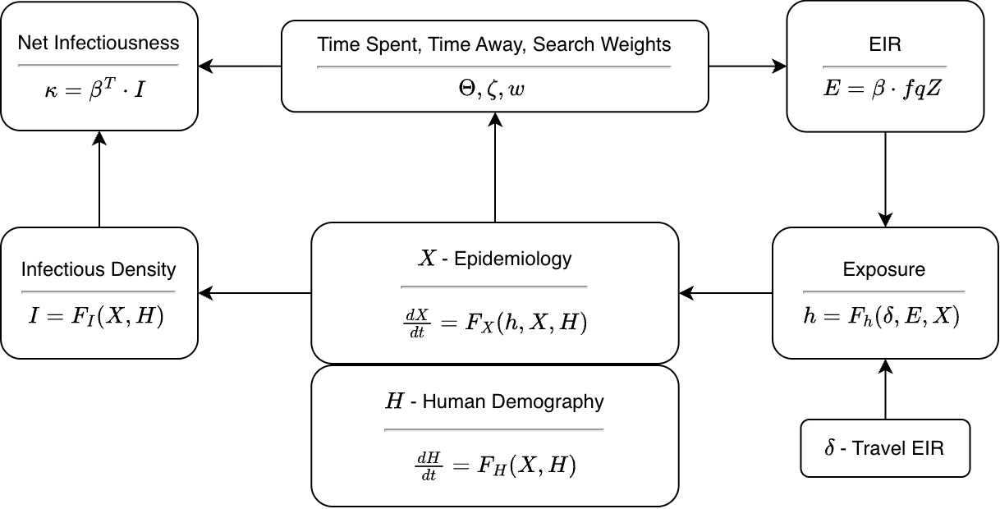

# The XH Component

The **XH** component was designed for human malaria epidemiology,
defined in a narrow sense to include exposure, infection dynamics,
immunity, disease, infectiousness, diagnostics and detection. In the
broader sense, human malaria epidemiology also includes malaria
transmission dynamics, but these aspects are handled by other parts of
**`ramp.xds`**.

The **XH** component also handles models for the demography, infection
dynamics, and immunity for other mosquito-borne diseases.

A library of **XH** modules can be found in
[**`ramp.library`**](https://dd-harp.github.io/ramp.library/).

This vignette takes a deep dive into the design and structure of the
**XH** component. It is useful for anyone who wants to learn more about
how the code works.

------------------------------------------------------------------------

A diagram of the **XH** component.

------------------------------------------------------------------------

## Overview

The **XH** component handles demography and epidemiology. The software
was designed to handle the epidemiology of *Plasmodium falciparum* in a
human population, but the interface has the capability of handling other
models for parasites and pathogens in human or vertebrate host
populations.

The interface handles malaria epidemiology in a narrow sense: it
includes exposure, infection, disease, immunity, infectiousness, and
diagnostics and detection. In the broad sense, malaria epidemiology
includes transmission dynamics and control, but these are handled by
other parts of the model.

Each **XH** module is defined by:

- An **X** component - disease dynamics

  - \\(X\\): a state space describing infection and immune states, and
    possibly other variables

  - *dynamics:* a system of equations describing the state transitions

  - *infectivity:* a function \\(F_b(X)\\) to compute partial immunity

  - *infectiousness:* a function \\(F_I(X)\\) describing the effective
    infectious density

- An **H** component - demography

  - *births:* population births configured through the demographic
    interface

  - *deaths and other transitions:* demographic processes configured
    through the demographic interface

Since the **X** component is embedded in the **H** component, the two
processes are handled together.

### The **X** Component

Models for disease dynamics are developed around a general notion of
exposure defined by two metrics: daily entomological inoculation rates
(dEIR or \\(E\\)) and either

- the daily force of infection (dFoI or \\(h\\)), the hazard rate for
  infection for humans / hosts who are susceptible to infection.

- the daily attack rate (dAR or \\(1-e^{-h}\\)), the daily probability
  of infection for humans / hosts who are susceptible to infection.

Some of the **X** component is handled in the *exposure* interface that
translates local dEIR into a measure of the total dFoI.

Disease dynamics are specified by one of two methods:

- for systems of differential equations, `dXHdt` compute the derivatives
  using the dFoI

- for discrete time systems, `Update_XHt` updates the state variables
  using the dAR

All **XH** modules must include a function that computes effective
infectious host density, \\(F_I(X, H)\\). Dividing this quantity by host
density gives the fraction of bites expected to infect a perfectly
competent mosquito.

All **XH** modules must include a function that computes true prevalence
from the states using `F_prevalence`.

Methods for predicted observed prevalence by light microscopy, rapid
diagnostic test, and PCR are available for modules where those outputs
are relevant and implemented. The module’s skill set records the
diagnostic capabilities it supports.

The shared setup initializes mass-treatment ports for mass drug
administration and mass screen and treat. A module supports those
interventions only if its state updates use the treatment terms;
supported capabilities are recorded in its skill set.

### The **H** Component

The **H** component handles demographic change in a model coupled to
disease dynamics. A large number of models has been developed that
assumes human / host population size is static. In **`ramp.xds`**, a
module *must* either:

- handle dynamically changing populations, and

  - the equations handle demographic changes

  - a constant population density model by default;

- **OR** report that demographic change is not part of its skill set

Models in **`ramp.xds`** (and in the satellite package
**`ramp.library`**) follow a convention in modeling demographic changes.
If **X** had \\(N_X\\) mutually exclusive and collectively exhaustive
states, the modules implement \\(N_X-1\\) equations for the state
variables. The compartment not computed is the class that receives
newborns, denoted \\({X}\_1\\) (or one of these, if two or more classes
get newborns.)

These models generally use \\(H\\) to denote the human / host population
density. Demography is configured through the shared [demographic
interface](https://dd-harp.github.io/ramp.xds/reference/setup_demog_obj.html),
including `Births(t, y, xds_obj, i)` and `Deaths(t, H, xds_obj, i)`. For
differential equation models, the population equation follows the form:

\\\[\frac{dH}{dt} = \mathrm{Births}(t,y) - \mathrm{Deaths}(t,H)\\\]

Each modeled state variable is subject to demographic deaths, as
implemented by the module. Disease-induced mortality is not a universal
part of the interface and is included only by modules that implement it.

The value of \\({X}\_1\\) is computed and assigned a name using:

\\\[X\_{1} = H - \sum\_{i\>1} X_i.\\\]

By default, the shared demographic setup uses no births or deaths;
non-trivial demographic processes are configured through the demographic
setup functions.

The demographic operator can also be modified to handle other dynamical
transitions among classes, which is handled through models for cohort
dynamics and *principled stratification*.

## Required Functions

Each **XH** module implements the methods needed to connect its model to
the **XH** interface. The exact method set depends on whether the module
uses differential equations or discrete-time updates; some outputs and
analysis methods are optional.

Some of these required functions are `S3` class functions in
[human-XH-interface.R](https://github.com/dd-harp/ramp.xds/blob/main/R/human-XH-interface.R).
Others are defined for each module.

One good example is the `SIS` module, posted in the `ramp.xds` github
repository
[human-XH-SIS.R](https://github.com/dd-harp/ramp.xds/blob/main/R/human-XH-SIS.R).

The required functions deal with various tasks for model building and
solving: constructing the **XH** model object; the dynamics; the
parameters; the variables and their initial values; computing terms and
standard outputs; and consistency checks. Optional outputs include other
metrics; functions to compute steady states; and module specific
functions to visualize the outputs.

Each module is defined by a string, generically called `XHname`, that
identifies the module: *e.g.* `SIS`.

### Dynamics

At least one of the following is implemented, depending on whether the
model family is a system of differential equations or a discrete-time
system:

- `dXHdt.XHname` :: computes derivatives for a differential equation
  model. The method receives `t`, `y`, `xds_obj`, and `i`; the daily FoI
  is available in `xds_obj$terms$FoI[[i]]`. The function is set up to be
  solved by [`deSolve::ode`](https://rdrr.io/pkg/deSolve/man/ode.html)
  or [`deSolve::dede`](https://rdrr.io/pkg/deSolve/man/dede.html).

&nbsp;

    foi <- xds_obj$terms$FoI[[i]]

- `Update_XHt.XHname` :: updates and returns the state variables for a
  discrete-time model. The method receives `t`, `y`, `xds_obj`, and `i`;
  the daily attack rate is available in `xds_obj$terms$AR[[i]]`.

&nbsp;

    ar <- xds_obj$terms$AR[[i]]

------------------------------------------------------------------------

## XH Model Object

Each module has a pair of functions that set up a structured list called
the **XH** model object. The object is a list that is assigned to a
`class` that dispatches the `S3` functions described below. It is a
compound list, where some of the sub-lists are assigned their own
`class` that dispatch other `S3` functions.

- `make_XH_obj_XHname` :: creates the module-specific **XH** model
  object, including its parameters and class:

- `setup_XH_obj.XHname` :: attaches that object to
  `xds_obj$XH_obj[[i]]`, sets initial values and the skill set, and
  initializes shared interface features such as demographic setup,
  mass-treatment ports, time away, and travel EIR.

- `setup_XH_ix.XHname` :: assigns indices to the model variables. This
  method is called as part of model setup.

### Parameters

- `change_XH_pars.XHname` changes the values of some parameters. It is
  designed to be used after setup. New parameter values are passed by
  name in a list called `options`.

- `get_XH_pars.XHname` is a utility to inspect the values of the
  parameters.

### Variables

Since the **XH** component is one of three, a function sets up the
indices for all the variables in a model.

Two other functions use those indices: one pulls the variables from the
state variable vector \\(y\\); the other one pulls the variables by name
from an output matrix returned by `xds_solve`.

After pulling, both functions return the variables by name in a list to
make it easy to inspect or use.

- `setup_XH_ix.XHname` - is the function that assigns an index to each
  variable in the model, and stores it as `xds_obj$XH_obj[[i]]$ix`. The
  indices are returned as a named list.

- `get_XH_vars.XHname` - retrieves the value of variables from the state
  variables vector \\(y\\) at a point in time and returns the values by
  name in a list; the function gets called by `dXHdt` and by
  `change_XH_inits` and it can be useful in other contexts.

- `parse_XH_orbits.XHname` - this function is like `get_XH_vars` but it
  parses the matrix of outputs returned by `xds_solve`.

### Initial Values

A set of functions sets up or changes the initial values for the state
variables.

- `make_XH_inits_XHname` - each model must include a function that makes
  a set of initial values as a named list. This function does not belong
  to any `S3` class, so it can take any form. The function should supply
  default initial values for all the variables. These can be overridden
  by passing new initial values in `options`.

- `setup_XH_inits.XHname` - calls `make_XH_inits_XHname`. The setup
  `options` are passed to override default values. The initial values
  are stored as `XH_obj$inits`; this method is called by
  `setup_XH_obj.XHname` during setup.

- `change_XH_inits.XHname` - a utility to change the initial values.

### Dynamical Terms

These methods provide quantities used by the rest of the model.

- `F_I.XHname` - computes effective infectious host density, used by the
  blood-feeding and transmission interfaces to compute \\(\kappa.\\)

- `F_H.XHname` - returns human/host population density.

- `F_infectivity.XHname` - computes the probability a host becomes
  infected per infectious bite. `Exposure` uses this method to translate
  local and travel EIR into FoI.

### Standard Outputs

Each module must output a few key quantities:

- `F_prevalence.XHname` - computes true prevalence.

- `F_ni.XHname` - computes net infectiousness (NI) for each stratum. The
  method is called after solving, and NI is attached to the parsed
  outputs. The formula is module-specific.

- `get_HTC.XHname` - computes human transmitting capacity, used by
  downstream analyses that compute threshold conditions.

### Consistency Checks

Some modules in **`ramp.xds`** or **`ramp.library`** have been included
for various reasons. Not all of those models are capable of being
extended. To help users avoid using models in ways that are not
appropriate, we developed two function classes:

- `get_skillset_XH.XHname` :: returns a list describing the module’s
  capabilities and limitations

- `check_XH.XHname` :: at the end of `xds_setup` and at the beginning of
  `xds_solve`, this function gets run to ensure that some quantities
  have been properly updated, and to see if anything has been added to a
  model that is not in its skill set.

## Optional Functions

The **XH** interface also sets up `S3` methods for optional functions,
but these might not be appropriate for all models. The module’s
`get_skillset_XH.XHname` method returns its capabilities and limitations
as a list, which setup stores on the module object.

### Diagnostic Outputs

The interface provides methods for predicted prevalence by diagnostic
method when these outputs are relevant and implemented by the module.

- `F_pfpr_by_lm.XHname` :: output predicted prevalence by light
  microscopy

- `F_pfpr_by_rdt.XHname` :: output predicted prevalence by rapid
  diagnostic test

- `F_pfpr_by_pcr.XHname` :: output predicted prevalence by PCR

### Steady States

Methods can be defined to compute steady states under static parameter
values.

- `steady_state_X.XHname` :: computes steady states for the **X**
  component as a function of FoI and H, if appropriate.

- `steady_state_XH.XHname` :: computes steady states for the **XH**
  component as a function of FoI, if appropriate.

### Visualization

Functions have been developed to plot the standard terms, but each
module can define its own method for plotting:

- `xds_plot_X.XHname` is a module specific plotting function for the
  epidemiology
