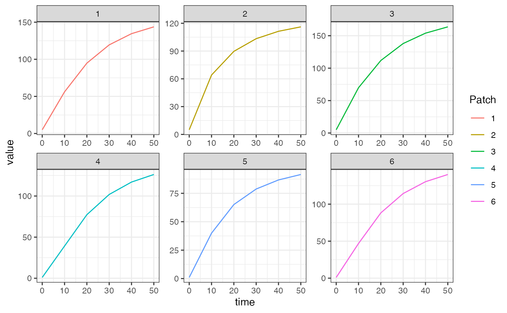

# Emergence

## A forced model

\
[`library`](https://rdrr.io/r/base/library.html)`(`[`ramp.xds`](https://dd-harp.github.io/ramp.xds/)`)`\
[`library`](https://rdrr.io/r/base/library.html)`(`[`MASS`](http://www.stats.ox.ac.uk/pub/MASS4/)`)`\
[`library`](https://rdrr.io/r/base/library.html)`(`[`expm`](https://R-Forge.R-project.org/projects/expm/)`)`\
[`library`](https://rdrr.io/r/base/library.html)`(`[`deSolve`](https://github.com/tpetzoldt/deSolve/)`)`\
[`library`](https://rdrr.io/r/base/library.html)`(`[`data.table`](https://r-datatable.com)`)`\
[`library`](https://rdrr.io/r/base/library.html)`(`[`ggplot2`](https://ggplot2.tidyverse.org)`)`

This is the null model of aquatic mosquito dynamics; there are no
endogenous dynamics and the model is simply specified by `Lambda`, the
rate at which adult mosquitoes spontaneously emerge from aquatic
habitats.

Below we show an example, taken from the package tests, of using the
trivial-based aquatic model to keep an adult mosquito model at
equilibrium when using unequal numbers of aquatic habitats per patch.

### The Long Way

First, we set the parameter values.

\
`nPatches`` ``<-`` ``3`\
`nHabitats`` ``<-`` ``4`\
`membership`` ``=`` `[`c`](https://rdrr.io/r/base/c.html)`(``1``,``2``,``3``,``3``)`\
`residence``=``1``:``3`\
`HPop`` ``=`` ``1000`

\
`calN`` ``<-`` `[`matrix`](https://rdrr.io/r/base/matrix.html)`(``0``, ``nPatches``, ``nHabitats``)`\
`calN``[``1``,``1``]`` ``<-`` ``1`\
`calN``[``2``,``2``]`` ``<-`` ``1`\
`calN``[``3``,``3``]`` ``<-`` ``1`\
`calN``[``3``,``4``]`` ``<-`` ``1`\
\
`calU`` ``<-`` `[`matrix`](https://rdrr.io/r/base/matrix.html)`(``0``, ``nHabitats``, ``nPatches``)`\
`calU``[``1``,``1``]`` ``<-`` ``1`\
`calU``[``2``,``2``]`` ``<-`` ``1`\
`calU``[``3``:``4``,``3``]`` ``<-`` ``0.5`

\
`f`` ``<-`` `[`rep`](https://rdrr.io/r/base/rep.html)`(``0.3``, ``nPatches``)`\
`q`` ``<-`` `[`rep`](https://rdrr.io/r/base/rep.html)`(``0.9``, ``nPatches``)`\
`g`` ``<-`` `[`rep`](https://rdrr.io/r/base/rep.html)`(``1``/``20``, ``nPatches``)`\
`sigma`` ``<-`` `[`rep`](https://rdrr.io/r/base/rep.html)`(``1``/``10``, ``nPatches``)`\
`mu`` ``<-`` `[`rep`](https://rdrr.io/r/base/rep.html)`(``0``, ``nPatches``)`` `\
`eip`` ``<-`` ``11`\
`nu`` ``<-`` ``1``/``2`\
`eggsPerBatch`` ``<-`` ``30`

\
`MYo`` ``=`` `[`list`](https://rdrr.io/r/base/list.html)`(`\
`  g``=``g``, sigma``=``sigma``, mu``=``mu``, f``=``f``, q``=``q``, nu``=``nu``, eggsPerBatch ``=`` ``eggsPerBatch`\
`)`

\
`K_matrix`` ``<-`` `[`diag`](https://rdrr.io/r/base/diag.html)`(``-``1``, ``nPatches``)`` `\
`K_matrix``[``1``, ``2``:``3``]`` ``<-`` `[`c`](https://rdrr.io/r/base/c.html)`(``0.2``, ``0.8``)`\
`K_matrix``[``2``, `[`c`](https://rdrr.io/r/base/c.html)`(``1``,``3``)``]`` ``<-`` `[`c`](https://rdrr.io/r/base/c.html)`(``0.5``, ``0.5``)`\
`K_matrix``[``3``, ``1``:``2``]`` ``<-`` `[`c`](https://rdrr.io/r/base/c.html)`(``0.7``, ``0.3``)`\
`K_matrix`` ``<-`` `[`t`](https://rdrr.io/r/base/t.html)`(``K_matrix``)`\
\
`Omega`` ``<-`` `[`F_Omega_xde`](https://dd-harp.github.io/ramp.xds/reference/F_Omega_xde.md)`(``g``, ``sigma``, ``mu``, ``K_matrix``)`\
`Upsilon`` ``<-`` ``expm``::`[`expm`](https://rdrr.io/pkg/expm/man/expm.html)`(``-``Omega`` ``*`` ``eip``)`\
\
`Lambda`` ``<-`` `[`c`](https://rdrr.io/r/base/c.html)`(``5``, ``10``, ``8``)`

Next, we calculate equilibrium values following the [Ross-Macdonald
vignette](https://dd-harp.github.io/ramp.xds/articles/adult_RM.md). We
use \\(\mathcal{N}\\) and \\(\mathcal{U}\\) to describe how aquatic
habitats are dispersed amongst patches, and how mosquitoes in each patch
disperse eggs to each habitat, respectively. Please note because we have
unequal numbers of aquatic habitats and patches, we use
[`MASS::ginv`](https://rdrr.io/pkg/MASS/man/ginv.html) to compute the
generalized inverse of \\(\mathcal{N}\\) to get \\(\alpha\\) required at
equilibrium.

\
`# equilibrium solutions`\
`Omega_inv`` ``<-`` `[`solve`](https://rdrr.io/pkg/Matrix/man/solve-methods.html)`(``Omega``)`\
\
`M_eq`` ``<-`` `[`as.vector`](https://rdrr.io/r/base/vector.html)`(``Omega_inv`` `[`%*%`](https://rdrr.io/r/base/matmult.html)` ``Lambda``)`\
`P_eq`` ``<-`` `[`as.vector`](https://rdrr.io/r/base/vector.html)`(`[`solve`](https://rdrr.io/pkg/Matrix/man/solve-methods.html)`(`[`diag`](https://rdrr.io/r/base/diag.html)`(``f``, ``nPatches``)`` ``+`` ``Omega``)`` `[`%*%`](https://rdrr.io/r/base/matmult.html)` `[`diag`](https://rdrr.io/r/base/diag.html)`(``f``, ``nPatches``)`` `[`%*%`](https://rdrr.io/r/base/matmult.html)` ``M_eq``)`\
\
`# the "Lambda" for the dLdt model`\
`alpha`` ``<-`` `[`as.vector`](https://rdrr.io/r/base/vector.html)`(`[`ginv`](https://rdrr.io/pkg/MASS/man/ginv.html)`(``calN``)`` `[`%*%`](https://rdrr.io/r/base/matmult.html)` ``Lambda``)`

Now we set up the model. Please see the [Ross-Macdonald
vignette](https://dd-harp.github.io/ramp.xds/articles/adult_RM.md) for
details on the adult model. We use `alpha` as the `Lambda` parameter of
our forced emergence model, in `ramp.xds::make_parameters_L_trivial`.
Again, because we are not running the full transmission model, we must
use `ramp.xds::MosquitoBehavior` to pass the equilibrium values of those
bionomic parameters to `ramp.xds::xDE_diffeqn_mosy`.

\
`xds_obj`` ``<-`` `[`make_xds_object_template`](https://dd-harp.github.io/ramp.xds/reference/make_xds_object_template.md)`(``"ode"``, ``"mosy"``, ``nPatches``, ``membership``, ``residence``)`\
`xds_obj``$``nHabitats`\
`#> [1] 4`\
`xds_obj``$``nStrata`\
`#> [1] 3`\
`xds_obj``$``nPatches`\
`#> [1] 3`

\
`xds_obj`` ``=`` `[`setup_L_obj`](https://dd-harp.github.io/ramp.xds/reference/setup_L_obj.md)`(``"trivial"``, ``membership``, ``xds_obj``, options ``=`` `[`list`](https://rdrr.io/r/base/list.html)`(``Lambda ``=`` ``alpha``)``, s``=``1``)`

\
`xds_obj`` ``=`` `[`setup_MY_obj`](https://dd-harp.github.io/ramp.xds/reference/setup_MY_obj.md)`(``"basicM"``, ``xds_obj``, options``=``MYo``, s``=``1``)`

\
`xds_obj`` ``=`` `[`setup_XH_obj`](https://dd-harp.github.io/ramp.xds/reference/setup_XH_obj.md)`(``"trivial"``, ``residence``, ``xds_obj``, options``=`[`list`](https://rdrr.io/r/base/list.html)`(``H``=``HPop``)``, i``=``1``)`

\
`xds_obj`` ``=`` `[`make_indices`](https://dd-harp.github.io/ramp.xds/reference/make_indices.md)`(``xds_obj``)`

\
`xds_obj``$``terms``$``kappa`` ``=`` `[`list`](https://rdrr.io/r/base/list.html)`(``)`\
`xds_obj``$``terms``$``kappa``[[``1``]``]`` ``=`` `[`rep`](https://rdrr.io/r/base/rep.html)`(``0``, ``nPatches``)``  `

\
`xds_obj`` ``<-`` `[`setup_K_matrix`](https://dd-harp.github.io/ramp.xds/reference/setup_K_matrix.md)`(``K_matrix``, ``xds_obj``)`

\
`y0`` ``<-`` `[`get_inits`](https://dd-harp.github.io/ramp.xds/reference/get_inits.md)`(``xds_obj``)`\
`y0`\
`#> $L`\
`#> list()`\
`#> `\
`#> $MY`\
`#> $MY$M`\
`#> [1] 5 5 5`\
`#> `\
`#> $MY$P`\
`#> [1] 1 1 1`\
`#> `\
`#> `\
`#> $X`\
`#> NULL`\
`#> `\
`#> $V`\
`#> NULL`

\
`tar`` ``<-`` `[`get_residence_matrix`](https://dd-harp.github.io/ramp.xds/reference/get_residence_matrix.md)`(``xds_obj``)`

\
`xds_obj`` ``=`` `[`setup_habitat_search_weights`](https://dd-harp.github.io/ramp.xds/reference/setup_habitat_search_weights.md)`(`[`rep`](https://rdrr.io/r/base/rep.html)`(``1``,``4``)``, ``xds_obj``)`` `\
`xds_obj`` ``=`` `[`compute_all_available_water`](https://dd-harp.github.io/ramp.xds/reference/compute_all_available_water.md)`(``xds_obj``)`\
`xds_obj`` ``=`` `[`compute_U_matrix`](https://dd-harp.github.io/ramp.xds/reference/compute_U_matrix.md)`(``xds_obj``)`

\
`out`` ``<-`` ``deSolve``::`[`ode`](https://rdrr.io/pkg/deSolve/man/ode.html)`(``y ``=`` `[`get_inits`](https://dd-harp.github.io/ramp.xds/reference/get_inits.md)`(``xds_obj``, flatten``=``TRUE``)``, times ``=`` `[`seq`](https://rdrr.io/r/base/seq.html)`(``0``,``50``, by``=``10``)``, func ``=`` ``xde_derivatives``, parms ``=`` ``xds_obj``, method ``=`` ``'lsoda'``)`\
`out1`` ``<-`` ``out`

\
[`colnames`](https://rdrr.io/r/base/colnames.html)`(``out``)``[``xds_obj``$``MY_obj``[[``1``]``]``$``ix``$``M_ix``+``1``]`` ``<-`` `[`paste0`](https://rdrr.io/r/base/paste.html)`(``'M_'``, ``1``:``xds_obj``$``nPatches``)`\
[`colnames`](https://rdrr.io/r/base/colnames.html)`(``out``)``[``xds_obj``$``MY_obj``[[``1``]``]``$``ix``$``P_ix``+``1``]`` ``<-`` `[`paste0`](https://rdrr.io/r/base/paste.html)`(``'P_'``, ``1``:``xds_obj``$``nPatches``)`\
\
`out`` ``<-`` `[`as.data.table`](https://rdrr.io/pkg/data.table/man/as.data.table.html)`(``out``)`\
`out`` ``<-`` `[`melt`](https://rdrr.io/pkg/data.table/man/melt.data.table.html)`(``out``, id.vars ``=`` ``'time'``)`\
`out``[``, `[`c`](https://rdrr.io/r/base/c.html)`(``"Component"``, ``"Patch"``)`` ``:=`` `[`tstrsplit`](https://rdrr.io/pkg/data.table/man/tstrsplit.html)`(``variable``, ``'_'``, fixed ``=`` ``TRUE``)``]`\
`out``[``, ``variable`` ``:=`` ``NULL``]`\
\
[`ggplot`](https://ggplot2.tidyverse.org/reference/ggplot.html)`(``data ``=`` ``out``, mapping ``=`` `[`aes`](https://ggplot2.tidyverse.org/reference/aes.html)`(``x ``=`` ``time``, y ``=`` ``value``, color ``=`` ``Patch``)``)`` ``+`\
`  `[`geom_line`](https://ggplot2.tidyverse.org/reference/geom_path.html)`(``)`` ``+`\
`  `[`facet_wrap`](https://ggplot2.tidyverse.org/reference/facet_wrap.html)`(``.`` ``~`` ``Component``, scales ``=`` ``'free'``)`` ``+`\
`  `[`theme_bw`](https://ggplot2.tidyverse.org/reference/ggtheme.html)`(``)`

### Using Setup

\
`Lo`` ``=`` `[`list`](https://rdrr.io/r/base/list.html)`(`\
`  Lambda ``=`` ``alpha`` `\
`)`

\
`MYo`` ``=`` `[`list`](https://rdrr.io/r/base/list.html)`(`\
`  f ``=`` ``0.3``,`\
`  q ``=`` ``0.9``,`\
`  g ``=`` ``1``/``20``,`\
`  sigma ``=`` ``1``/``10``,`\
`  eip ``=`` ``11``,`\
`  nu ``=`` ``1``/``2``,`\
`  eggsPerBatch ``=`` ``30``,`\
`  M``=``M_eq``,`\
`  P``=``P_eq`\
`)`

\
[`xds_setup_mosy`](https://dd-harp.github.io/ramp.xds/reference/xds_setup_mosy.md)`(``MYname ``=`` ``"basicM"``, Lname ``=`` ``"trivial"``, `\
`               nPatches ``=`` ``3``, membership ``=`` `[`c`](https://rdrr.io/r/base/c.html)`(``1``,``2``,``3``,``3``)``, `\
`               MYoptions ``=`` ``MYo``, Koptions ``=`` ``K_matrix``, `\
`               HPop``=``HPop``, Loptions ``=`` ``Lo``)``->``mosy1`

\
[`xds_solve`](https://dd-harp.github.io/ramp.xds/reference/xds_solve.md)`(``mosy1``,Tmax``=``50``,dt``=``10``)``$``outputs``$``deout`` ``->`` ``out2`

\
[`sum`](https://rdrr.io/r/base/sum.html)`(`[`abs`](https://rdrr.io/r/base/MathFun.html)`(``out2``-``out1``)``)`\
`#> [1] 2093.928`
