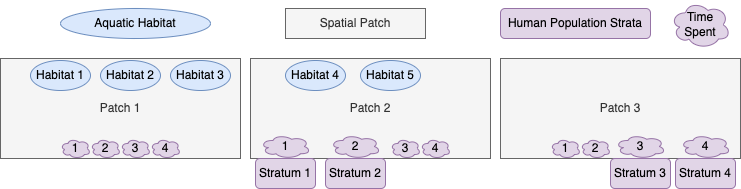
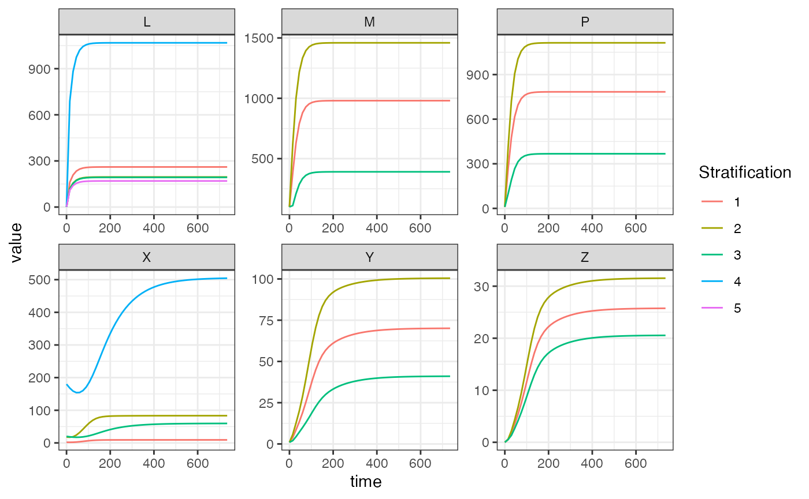
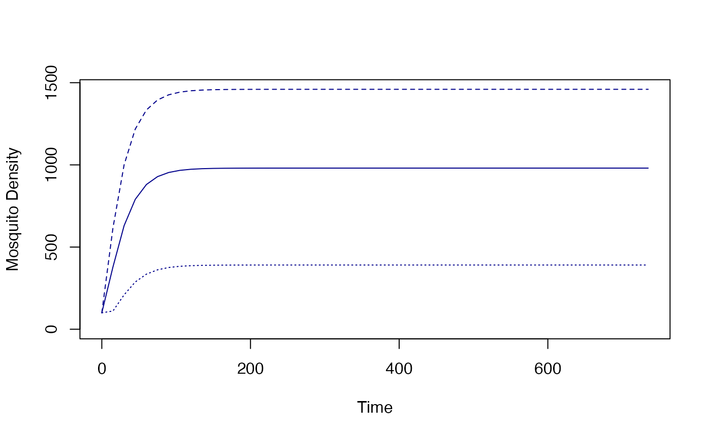

# 5-3-4 Example

\
[`library`](https://rdrr.io/r/base/library.html)`(`[`ramp.xds`](https://dd-harp.github.io/ramp.xds/)`)`\
[`library`](https://rdrr.io/r/base/library.html)`(`[`expm`](https://R-Forge.R-project.org/projects/expm/)`)`\
[`library`](https://rdrr.io/r/base/library.html)`(`[`data.table`](https://r-datatable.com)`)`\
[`library`](https://rdrr.io/r/base/library.html)`(`[`ggplot2`](https://ggplot2.tidyverse.org)`)`\
[`library`](https://rdrr.io/r/base/library.html)`(`[`deSolve`](https://github.com/tpetzoldt/deSolve/)`)`

## Introduction

This vignette illustrates how to setup, solve, and analyze models of
mosquito-borne pathogen transmission dynamics and control using modular
software. Modularity, with flexible structural parameters, illustrated
by constructing a model with

- five aquatic habitats (\\(N_q=5\\));

- three patches (\\(N_p=3\\)); and

- four human population strata (\\(N_h=4\\)).

We call it `5-3-4`.

### Diagram

The model `5-3-4` is designed to illustrate some important features of
the framework and notation. We assume that:

- the first three habitats are found in patch 1; the last two are in
  patch 2; patch 3 has no habitats.

- patch 1 has no residents; patches 2 and 3 are occupied, each with two
  different population strata;

- Transmission among patches is modeled using the concept of *time
  spent*, which is similar to the *visitation rates* that have been used
  in other models. While the strata have a residency (i.e; a patch they
  spend most of their time in), each stratum allocates their time across
  all the habitats.

### Encoding Structural Information

Basic location information can be encoded in vectors. One vector, called
the habitat membership vector or `membership`, holds information about
the location of habitats. Another vector, called\
the strata residency vector or `residence`, encodes the information
about where people live.

For the aquatic habitats, the habitat membership vector is an ordered
list of the index of patches where the habitats are found:

\
`membership`` ``=`` `[`c`](https://rdrr.io/r/base/c.html)`(``1``,``1``,``1``,``2``,``2``)`\
`membership`

    ## [1] 1 1 1 2 2

The number of habitats, \\(n_q\\) or `nHabitats`, is the length of the
membership matrix:

\
`nHabitats`` ``=`` `[`length`](https://rdrr.io/r/base/length.html)`(``membership``)`\
`nHabitats`

    ## [1] 5

For the human population strata, the residence vector is an ordered list
of the index of patches where people live:

\
`residence`` ``=`` `[`c`](https://rdrr.io/r/base/c.html)`(``2``,``2``,``3``,``3``)`\
`residence`

    ## [1] 2 2 3 3

The number of strata, \\(n_h\\) or `nStrata`, is the length of the
residence matrix:

\
`nStrata`` ``=`` `[`length`](https://rdrr.io/r/base/length.html)`(``residence``)`\
`nStrata`

    ## [1] 4

The number of patches, \\(n_p\\) or `nPatches`, is just a number:

\
`nPatches`` ``=`` ``3`

### Aquatic Habitat Membership Matrix

For computation, `ramp.xds` uses an \\(n_p \times n_q\\) matrix called
\\(N.\\) It is specified by the habitat vector. In the matrix,
\\(N\_{i,j}\\) is \\(1\\) if the \\(i^{th}\\) patch contains the
\\(j^{th}\\) habitat:

\\\[\begin{equation} {N} = \left\[ \begin{array}{ccccc} 1 & 1 & 1 & 0 &
0 \\\\ 0 & 0 & 0 & 1 & 1\\\\ 0 & 0 & 0 & 0 & 0\\\\ \end{array} \right\]
\end{equation}\\\]

The matrix is created by a function `make_habitat_matrix`:

\
`habitat_matrix`` ``=`` `[`make_habitat_matrix`](https://dd-harp.github.io/ramp.xds/reference/make_habitat_matrix.md)`(``nPatches``, ``membership``)`\
`habitat_matrix`

    ##      [,1] [,2] [,3] [,4] [,5]
    ## [1,]    1    1    1    0    0
    ## [2,]    0    0    0    1    1
    ## [3,]    0    0    0    0    0

The habitat matrix is used to sum quantities in habitats up to patches.
For example, the number of habitats per patch is \\({N} \cdot 1\\),
where \\(1\\) is a vector of 1’s:

\
[`as.vector`](https://rdrr.io/r/base/vector.html)`(``habitat_matrix`` `[`%*%`](https://rdrr.io/r/base/matmult.html)` `[`rep`](https://rdrr.io/r/base/rep.html)`(``1``,``5``)``)`` `

    ## [1] 3 2 0

### The Residence Matrix

For computation, `ramp.xds` also creates a \\(n_p \times n_h\\) matrix
called \\(\cal J.\\) It is specified by residence vector. The element
\\({\cal J}\_{i,j}\\) is \\(1\\) if the \\(j^{th}\\) stratum resides in
the \\(i^{th}\\) patch:

\\\[\begin{equation} {J} = \left\[ \begin{array}{cccc} 0 & 0 & 0 & 0
\\\\ 1 & 1 & 0 & 0 \\\\ 0 & 0 & 1 & 1 \\\\ \end{array} \right\]
\end{equation}\\\]

The matrix is created by a function `make_residency_matrix`:

\
`residence_matrix`` ``=`` `[`make_residence_matrix`](https://dd-harp.github.io/ramp.xds/reference/make_residence_matrix.md)`(``nPatches``, ``residence``)`\
`residence_matrix`

    ##      [,1] [,2] [,3] [,4]
    ## [1,]    0    0    0    0
    ## [2,]    1    1    0    0
    ## [3,]    0    0    1    1

The number of strata per patch is:

\
[`as.vector`](https://rdrr.io/r/base/vector.html)`(``residence_matrix`` `[`%*%`](https://rdrr.io/r/base/matmult.html)` `[`rep`](https://rdrr.io/r/base/rep.html)`(``1``,``4``)``)`` `

    ## [1] 0 2 2

### Egg Laying

It is plausible that these habitats are not all found with the same
propensity. Habitats are found after a search, and that search begins
after mosquitoes have blood fed. To compute egg distribution, we create
a vector describing habitat *search weights,* denoted \\(\omega.\\) The
proportion of eggs laid in each patch is it’s search weight as a
proportion of summed search weights of all habitats in a patch, a
quantity that we have called *availability,* \\(Q\\).

For now, we generate arbitary weights for each one of the habitats:

\
`searchWtsQ`` ``=`` `[`c`](https://rdrr.io/r/base/c.html)`(``7``,``2``,``1``,``8``,``2``)`\
`searchWtsQ`

    ## [1] 7 2 1 8 2

And we can compute availability as \\(N \cdot w\\). In `ramp.xds`, the
function that computes habitat availability is called `F_Q`:

\
`Q`` ``<-`` `[`F_available_habitat`](https://dd-harp.github.io/ramp.xds/reference/F_available_habitat.md)`(``habitat_matrix``, ``searchWtsQ``)`\
`Q`

    ## [1] 10 10  0

Eggs are distributed among habitats in proportion to the relative values
of the habitat search weights. These habitat search weights and
availability can be used to compute the values of some adult mosquito
bionomic parameters using *functional responses,* that make use of their
absolute values. The absolute values only have a meaning through their
effects.

The egg dispersal matrix \\(U\\) is a \\(n_q \times n_p\\) matrix
describing how eggs laid by adult mosquitoes in a patch are allocated
among the aquatic habitats in that patch. It is a matrix of search
weights normalized by availability:

\\\[\begin{equation} U = \left\[ \begin{array}{ccccc} .7 & 0 & 0\\\\ .2
& 0 & 0\\\\ .1 & 0 & 0\\\\ 0 & .8 & 0\\\\ 0 & .2 & 0\\\\ \end{array}
\right\] \end{equation}\\\]

It is computed using the function `make_U_matrix` that takes care of a
problem that could arise from having empty patches, like patch 3 in this
model.

\
`O_matrix`` ``=`` `[`make_U_matrix`](https://dd-harp.github.io/ramp.xds/reference/make_U_matrix.md)`(``searchWtsQ``, ``habitat_matrix``, ``Q``)`\
`O_matrix`

    ##      [,1] [,2] [,3]
    ## [1,]  0.7  0.0    0
    ## [2,]  0.2  0.0    0
    ## [3,]  0.1  0.0    0
    ## [4,]  0.0  0.8    0
    ## [5,]  0.0  0.2    0

### Blood Feeding

Blood feeding is an activity that involves mosquitoes and humans:
mosquitoes are searching for vertebrate hosts to feed on, and they find
and feed on humans and other vertebrate hosts. The blood feeding
constructs in `ramp.xds` translate this into a set of algorithms. The
host population can be subdivided into a set of strata, and those humans
spend time in the patches around home. Both humans and mosquitoes have
daily activity patterns, so that human time spent and relative mosquito
activity rates can change during the day. Time spent is thus translated
into **time at risk.** Like the habitats, the availability of those
hosts to blood feeding mosquitoes is affected by a set of *search
weights.*

This model has four population strata with even search weights:

\
`searchWtsH`` ``=`` `[`c`](https://rdrr.io/r/base/c.html)`(``1``,``1``,``1``,``1``)`

This size of each population stratum differs:

\
`HPop`` ``<-`` `[`c`](https://rdrr.io/r/base/c.html)`(``10``,``90``, ``100``, ``900``)`

The time spent matrix, \\(\Theta\\) is a \\(n_p \times n_h\\) matrix.
Each column describes how a human stratum allocates time among patches.

\\\[\begin{equation} \Theta = \left\[ \begin{array}{cccc} 0.01 & .01 &
.001 & .001 \\\\ 0.95 & .92 & .04 & .02 \\\\ 0.04 & .02 & .959 & .929
\\\\ \end{array} \right\] \end{equation}\\\]

This model does not consider daily patterns in human or mosquito
activity, so time spent and time at risk are identical.

\
`TaR`` ``<-`` `[`t`](https://rdrr.io/r/base/t.html)`(`[`matrix`](https://rdrr.io/r/base/matrix.html)`(`\
` `[`c`](https://rdrr.io/r/base/c.html)`(`[`c`](https://rdrr.io/r/base/c.html)`(``0.01``,``0.01``,``0.001``,``0.001``)``,`\
`  `[`c`](https://rdrr.io/r/base/c.html)`(``.95``,``.92``,``.04``,``.02``)``,`\
`  `[`c`](https://rdrr.io/r/base/c.html)`(``.04``,``.02``,``.959``,``.929``)``)``, ``4``, ``3`\
`)``)`

The availability of hosts is of time at risk and the population density
weighed by their search weights:

\
`W`` ``<-`` `[`F_W_available`](https://dd-harp.github.io/ramp.xds/reference/F_W_available.md)`(``searchWtsH``, ``HPop``, ``TaR``)`\
`W`

    ## [1]   2.0 114.3 934.2

### Transmission

A mixing matrix, \\(\beta\\), describes the expected proportion of each
infective bite that would be received be each population stratum.

\
[`F_beta`](https://dd-harp.github.io/ramp.xds/reference/F_beta.md)`(``HPop``, ``W``, ``searchWtsH``, ``TaR``)`

    ##       [,1]         [,2]         [,3]
    ## [1,] 5e-03 0.0083114611 4.281738e-05
    ## [2,] 5e-03 0.0080489939 2.140869e-05
    ## [3,] 5e-04 0.0003499563 1.026547e-03
    ## [4,] 5e-04 0.0001749781 9.944337e-04

### Aquatic Mosquito Dynamics

For this simulation, we use the basic competition model of larval
dynamics called `basicL` (see more
[here](https://dd-harp.github.io/ramp.xds/articles/aqua_basic.md)). It
requires specification of three parameters, \\(\psi\\) (maturation
rates), \\(\phi\\) (density-independent mortality rates), and
\\(\theta\\) (density-dependent mortality terms), and initial
conditions. The function `ramp.xds::xde_setup_L_obj_basicL` does basic
checking of the input parameters and returns a list with the correct
class for method dispatch. The returned list is attached to the main
parameter list with name `L_obj`.

\
`psi`` ``<-`` `[`rep`](https://rdrr.io/r/base/rep.html)`(``1``/``8``, ``nHabitats``)`\
`phi`` ``<-`` `[`rep`](https://rdrr.io/r/base/rep.html)`(``1``/``8``, ``nHabitats``)`\
`theta`` ``<-`` `[`c`](https://rdrr.io/r/base/c.html)`(``1``/``10``, ``1``/``20``, ``1``/``40``, ``1``/``100``, ``1``/``10``)`` `\
\
`L_obj`` ``=`` `[`make_L_obj_basicL`](https://dd-harp.github.io/ramp.xds/reference/make_L_obj_basicL.md)`(``nHabitats``, psi``=``psi``, phi``=``phi``, theta ``=`` ``theta``)`\
`L_obj``$``membership`` ``=`` ``membership`

### Adult Mosquito Dynamics

It also uses the Ross-Macdonald model (see more
[here](https://dd-harp.github.io/ramp.xds/articles/adult_RM.md)). Part
of the specification of parameters includes the construction of the
mosquito dispersal matrix \\(\mathcal{K}\\), and the mosquito demography
matrix \\(\Omega\\). Like for the aquatic parameters, we use
`ramp.xds::make_parameters_MYZ_RM_ode` to check parameter types and
return a list with the correct class for method dispatch.

The parameter values are:

\
`g`` ``<-`` `[`rep`](https://rdrr.io/r/base/rep.html)`(``1``/``12``, ``nPatches``)`` `\
`sigma`` ``<-`` `[`rep`](https://rdrr.io/r/base/rep.html)`(``1``/``12``/``2``, ``nPatches``)`` `\
`mu`` ``<-`` `[`rep`](https://rdrr.io/r/base/rep.html)`(``0``, ``nPatches``)`` `\
`f`` ``<-`` ``1``/``3`` `\
`q`` ``<-`` ``0.9`` `\
`nu`` ``<-`` `[`c`](https://rdrr.io/r/base/c.html)`(``1``/``3``,``1``/``3``,``0``)``  `\
`eip`` ``<-`` ``12`` `\
`eggsPerBatch`` ``<-`` ``30`` `

We create a named list:

\
`MYZo`` ``=`` `[`list`](https://rdrr.io/r/base/list.html)`(``g``=``g``, sigma``=``sigma``, mu``=``mu``, f``=``f``, q``=``q``, nu``=``nu``, eip``=``eip``, eggsPerBatch``=``eggsPerBatch``)`

Mosquito dispersal among the patches is described by a matrix, \\(K.\\)
Each column in \\(K\\) describes the proportion of emigrating mosquitoes
that go to every other patch. The diagonal elements are all \\(0\\):

\
`Kmatrix`` ``<-`` `[`t`](https://rdrr.io/r/base/t.html)`(`[`matrix`](https://rdrr.io/r/base/matrix.html)`(`\
` `[`c`](https://rdrr.io/r/base/c.html)`(`[`c`](https://rdrr.io/r/base/c.html)`(``-``1``, ``.6``, ``.3``)``, `\
`  `[`c`](https://rdrr.io/r/base/c.html)`(``.4``, ``-``1``, ``.7``)``, `\
`  `[`c`](https://rdrr.io/r/base/c.html)`(``.6``, ``.4``, ``-``1``)``)``, ``3``, ``3``)``)`

We construct the demographic matrix \\(\Omega\\) given by the formula
\\\[\Omega = \mbox{diag}\left(g\right) - K \cdot
\mbox{diag}\left(\sigma\right)\left(1-\mu\right)\\\] It is computed by
`compute_Omega_xde`:

\
`Omega`` ``<-`` `[`F_Omega_xde`](https://dd-harp.github.io/ramp.xds/reference/F_Omega_xde.md)`(``g``, ``sigma``, ``mu``, ``Kmatrix``)`

Survival and dispersal through the EIP in this model, denoted
\\(\Upsilon,\\) is computed using matrix exponentiation:

\
`Upsilon`` ``<-`` ``expm``::`[`expm`](https://rdrr.io/pkg/expm/man/expm.html)`(``-``Omega``*``eip``)`

The function `xde_setup_MY_obj_RM` can be used to construct the adult
mosquito model object, called `MY_obj.`

\
`MY_obj`` ``=`` `[`make_MY_obj_macdonald`](https://dd-harp.github.io/ramp.xds/reference/make_MY_obj_macdonald.md)`(``nPatches``, ``MYZo``)`` `\
[`class`](https://rdrr.io/r/base/class.html)`(``MY_obj``)`` ``<-`` ``"macdonald"`

The parameters are assigned to a list called `baseline` so that it can
be stored and used to compute the values of bionomic parameters that
have been modified by control.

\
[`names`](https://rdrr.io/r/base/names.html)`(``MY_obj``)`

    ## [1] "nPatches"     "eip"          "f"            "q"            "g"           
    ## [6] "sigma"        "mu"           "nu"           "eggsPerBatch"

### Human Infection Dynamics

We use a static demographic model, which assumes a constant population
size (constant \\(H\\)).

The 5-3-4 model uses the basic SIS (Susceptible-Infected-Susceptible)
model for the human component (see more
[here](https://dd-harp.github.io/ramp.xds/articles/human_sis.md)). It
can be configured using `ramp.xds::xde_setup_XH_obj_SIS.`

\
`r`` ``<-`` ``1``/``200`\
`b`` ``<-`` ``0.55`\
`c`` ``<-`` `[`c`](https://rdrr.io/r/base/c.html)`(``0.1``, ``.02``, ``.1``, ``.02``)`

The model is configured and assigned the name `XH_obj`:

\
`XH_obj`` ``<-`` `[`make_XH_obj_SIS`](https://dd-harp.github.io/ramp.xds/reference/make_XH_obj_SIS.md)`(``nStrata``, `[`list`](https://rdrr.io/r/base/list.html)`(``)``, ``b``, ``r``, ``c``)`\
`XH_obj``$``residence`` ``=`` ``residence`

### Initial Conditions

To solve the model, each variable needs an initial value. For the
aquatic model:

\
`Linits`` ``<-`` `[`list`](https://rdrr.io/r/base/list.html)`(`\
`  L ``=`` `[`rep`](https://rdrr.io/r/base/rep.html)`(``1``, ``nHabitats``)`\
`)`

For the adult mosquito model:

\
`MYZinits`` ``=`` `[`list`](https://rdrr.io/r/base/list.html)`(`\
`  M ``=`` `[`rep`](https://rdrr.io/r/base/rep.html)`(``100``, ``nPatches``)``,`\
`  P ``=`` `[`rep`](https://rdrr.io/r/base/rep.html)`(``10``, ``nPatches``)``,`\
`  Y ``=`` `[`rep`](https://rdrr.io/r/base/rep.html)`(``1``, ``nPatches``)``,`\
`  Z ``=`` `[`rep`](https://rdrr.io/r/base/rep.html)`(``0``, ``nPatches``)`\
`)`

For the human model:

\
`Xinits`` ``=`` `[`list`](https://rdrr.io/r/base/list.html)`(``I ``=`` `[`as.vector`](https://rdrr.io/r/base/vector.html)`(``0.2``*``HPop``)``, H``=``HPop``)`

### The `xds` Template

To build a model, `ramp.xds` must create an template that stores the
information about the patches, habitats, and strata in a rigid form. The
functions that solve and analyze the systems of differential equations
are, like most computer programs, unforgiving. An object describing a
model that can be solved by `ramp.xds` is called an `xds` object.
`ramp.xds` supports nimble model building for e**x**tensible
**d**ynamical **s**ystems, including e**x**tensible systems of
**d**ifferential equations (`xde`), and **d**iscrete-**t**ime
**s**ystems using difference equations (`dts`).

Since the software is designed to solve very complex systems, we will
need to create an object that *could* accommodate added realism (*e.g.*
vector control). The function `make_xds_object_template` sets up a
compound list in `R` that is like a building that we anticipate
modifying, with *ports* and *junctions* ready. These capabilities that
are not needed by simple models. The software’s requires that some
objects are present to handle all that complexity. Since most users
won’t want to learn about the details, the software includes a function,
called `make_xds_object_template` that sets up the scaffolding for a
model, including many that are set to their `null` values (turned off).

A user only needs to know how to encode the information and what
information to encode. The rest is handled by functions. It is helpful
for users to understand some of the notation and terms. The following
are set up in order by `make_xds_object_template`:

- the first required argument sets the value and class of `xds`

  - `xde` is for e**x**tensible systems of **d**ifferential
    **e**quations

  - `dts` is for not a **d**iscrete-**t**ime **s**ystems

- the second required arugment sets the value and class of `frame` that
  dispatches *both* a setup function and a class of `xde_derivatives`
  (for `xde` models) or a class of `dts_update` (for `dts` models)

  - `full` tells us the model should configure and compute all three
    dynamical components

  - Other options – `mosy`, `aquatic`, `human`, and `cohort` – work on
    subsets of the components, and while they could be configured using
    `full`

- the third required term sets the value of`dlay` that dispatches
  `xds_solve`

  - `ode` uses
    [`deSolve::ode`](https://rdrr.io/pkg/deSolve/man/ode.html) for
    ordinary differential equations,

  - `dde` uses `deSolve:dde` for delay differential equations

- the next three arguments are `nPatches` and `membership` and
  `residence`, as explained above.

\
`xds_obj`` ``=`` `[`make_xds_object_template`](https://dd-harp.github.io/ramp.xds/reference/make_xds_object_template.md)`(``"dde"``, ``"full"``, ``nPatches``, ``membership``, ``residence``)`` `

After being set up:

\
[`c`](https://rdrr.io/r/base/c.html)`(``xds_obj``$``nHabitats``, ``xds_obj``$``nPatches``, ``xds_obj``$``nStrata``)`

    ## [1] 5 3 4

If we want to retrieve the membership matrix, we can call
`get_habitat_matrix`

\
[`get_habitat_matrix`](https://dd-harp.github.io/ramp.xds/reference/get_habitat_matrix.md)`(``xds_obj``)`

    ##      [,1] [,2] [,3] [,4] [,5]
    ## [1,]    1    1    1    0    0
    ## [2,]    0    0    0    1    1
    ## [3,]    0    0    0    0    0

The function `make_xds_object_template` was designed to create a
scaffolding. So `Q` gets created with default values: all patches are
assumed to have the same biting weights.

\
`xds_obj``$``terms``$``Q`

    ## [[1]]
    ## [1] 1 1 1

A little detail to note is that an `xds` object is designed to handle
multiple vector and multiple host species. The function
`make_xds_object_template` only sets up the first species. Similarly, we
can view the egg distribution matrix for the first species:

\
`xds_obj``$``habitats``$``laying_matrix`

    ## list()

While this is a reasonable way to start, we don’t want to get stuck
using the default values.

To make a modular system that works as expected, we need to adopt some
conventions for setting the values of parameters. This can create
challenges because after changing the *search weights,* we will also
need to update *habitat availability* and the *egg distribution matrix.*
Updating all of that by hand would be cumbersome, so `ramp.xds` has
adopted some conventions for changing parameter values and then updating
the objects that depend on them.

#### Building the Object

\
`xds_obj``$``L_obj`` ``=`` `[`list`](https://rdrr.io/r/base/list.html)`(``)`` `\
`xds_obj``$``L_obj``[[``1``]``]`` ``=`` ``L_obj`\
`xds_obj``$``MY_obj`` ``=`` `[`list`](https://rdrr.io/r/base/list.html)`(``)`` `\
`xds_obj``$``MY_obj``[[``1``]``]`` ``=`` ``MY_obj`` `\
`xds_obj``$``XH_obj`` ``=`` `[`list`](https://rdrr.io/r/base/list.html)`(``)`` `\
`xds_obj``$``XH_obj``[[``1``]``]`` ``=`` ``XH_obj`` `

\
`xds_obj`` ``<-`` `[`setup_L_inits`](https://dd-harp.github.io/ramp.xds/reference/setup_L_inits.md)`(``xds_obj``, ``1``, ``Linits``)`\
`xds_obj`` ``<-`` `[`setup_MY_inits`](https://dd-harp.github.io/ramp.xds/reference/setup_MY_inits.md)`(``xds_obj``, ``1``, ``MYZinits``)`\
`xds_obj`` ``<-`` `[`setup_XH_inits`](https://dd-harp.github.io/ramp.xds/reference/setup_XH_inits.md)`(``xds_obj``, options``=``Xinits``, i``=``1``)`

After the parameters for `5-3-4` have been specified, we can generate
the indices for the model and attach them to the parameter list.

\
`xds_obj`` ``=`` `[`make_indices`](https://dd-harp.github.io/ramp.xds/reference/make_indices.md)`(``xds_obj``)`

#### Setting Parameter Values

To assign new values for the habitat search weights, we use a function
called `set_habitat_wts_static.` After setting the values of the habitat
search weights, we need to update habitat availability and the egg
distribution matrix. The functions `makeQ` and `make_Umatrix` do this.

\
`xds_obj`` ``<-`` `[`setup_habitat_search_weights`](https://dd-harp.github.io/ramp.xds/reference/setup_habitat_search_weights.md)`(``searchWtsQ``, ``xds_obj``)`

We can check to see

\
`xds_obj``$``terms``$``Q``[[``1``]``]`

    ## [1] 10 10  0

\
`xds_obj``$``habitats``$``laying_matrix``[[``1``]``]`

    ##      [,1] [,2] [,3]
    ## [1,]  0.7  0.0    0
    ## [2,]  0.2  0.0    0
    ## [3,]  0.1  0.0    0
    ## [4,]  0.0  0.8    0
    ## [5,]  0.0  0.2    0

\
`xds_obj``$``XH_obj``[[``1``]``]``$``timespent`` ``=`` ``TaR`\
`xds_obj``$``XH_obj``[[``1``]``]``$``timespent_obj`` ``=`` ``make_static_obj`\
`xds_obj`` ``<-`` `[`setup_time_away`](https://dd-harp.github.io/ramp.xds/reference/setup_time_away.md)`(``"setup"``, ``xds_obj``)`\
`xds_obj`` ``<-`` `[`setup_F_circadian`](https://dd-harp.github.io/ramp.xds/reference/setup_F_circadian.md)`(``"setup"``, ``xds_obj``)`

\
`xds_obj``$``XH_obj``[[``1``]``]``$``timespent`

    ##      [,1] [,2]  [,3]  [,4]
    ## [1,] 0.01 0.01 0.001 0.001
    ## [2,] 0.95 0.92 0.040 0.020
    ## [3,] 0.04 0.02 0.959 0.929

\
`xds_obj``$``XH_obj``[[``1``]``]``$``time_away``=`[`rep`](https://rdrr.io/r/base/rep.html)`(``0``, ``4``)`\
[`get_time_away`](https://dd-harp.github.io/ramp.xds/reference/get_time_away.md)`(``xds_obj``)`

    ## [1] 0 0 0 0

\
`xds_obj`` ``<-`` `[`compute_TaR`](https://dd-harp.github.io/ramp.xds/reference/compute_TaR.md)`(``xds_obj``,``0``)`\
`xds_obj``$``terms``$``TaR`

    ## [[1]]
    ## [[1]][[1]]
    ##      [,1] [,2]  [,3]  [,4]
    ## [1,] 0.01 0.01 0.001 0.001
    ## [2,] 0.95 0.92 0.040 0.020
    ## [3,] 0.04 0.02 0.959 0.929

\
`xds_obj`` ``<-`` `[`setup_blood_search_weights`](https://dd-harp.github.io/ramp.xds/reference/setup_blood_search_weights.md)`(``searchWtsH``, ``xds_obj``)`\
`xds_obj`` ``<-`` `[`setup_other_blood_hosts`](https://dd-harp.github.io/ramp.xds/reference/setup_other_blood_hosts.md)`(`[`rep`](https://rdrr.io/r/base/rep.html)`(``0``, ``nPatches``)``, ``xds_obj``)`\
`xds_obj`` ``<-`` `[`setup_blood_traps`](https://dd-harp.github.io/ramp.xds/reference/setup_blood_traps.md)`(`[`rep`](https://rdrr.io/r/base/rep.html)`(``0``, ``nPatches``)``, ``xds_obj``)`\
`xds_obj`` ``<-`` `[`setup_travel_eir`](https://dd-harp.github.io/ramp.xds/reference/setup_travel_eir.md)`(``"no_travel"``, ``xds_obj``)`\
`y0`` ``<-`` `[`get_inits`](https://dd-harp.github.io/ramp.xds/reference/get_inits.md)`(``xds_obj``)`\
`xds_obj`` ``<-`` `[`compute_WB`](https://dd-harp.github.io/ramp.xds/reference/compute_WB.md)`(``0``, ``y0``, ``xds_obj``)`

\
`xds_obj``$``terms``$``W``[[``1``]``]`

    ## [1]   2.0 114.3 934.2

\
`xds_obj`` ``<-`` `[`setup_Omega_obj`](https://dd-harp.github.io/ramp.xds/reference/setup_Omega_obj.md)`(``"xde"``, ``"static"``, ``xds_obj``, ``1``)`\
`xds_obj`` ``<-`` `[`setup_Upsilon_obj`](https://dd-harp.github.io/ramp.xds/reference/setup_Upsilon_obj.md)`(``xds_obj``, ``1``, ``TRUE``)`\
`xds_obj`` ``<-`` `[`setup_K_matrix`](https://dd-harp.github.io/ramp.xds/reference/setup_K_matrix.md)`(``Kmatrix``, ``xds_obj``)`\
`xds_obj``$``MY_obj``[[``1``]``]``$``K_matrix`

    ##      [,1] [,2] [,3]
    ## [1,] -1.0  0.6  0.3
    ## [2,]  0.4 -1.0  0.7
    ## [3,]  0.6  0.4 -1.0

\
[`get_Omega`](https://dd-harp.github.io/ramp.xds/reference/get_Omega.md)`(``xds_obj``, ``1``)`` `

    ##             [,1]        [,2]        [,3]
    ## [1,]  0.12500000 -0.02500000 -0.01250000
    ## [2,] -0.01666667  0.12500000 -0.02916667
    ## [3,] -0.02500000 -0.01666667  0.12500000

\
[`get_Upsilon`](https://dd-harp.github.io/ramp.xds/reference/get_Upsilon.md)`(``xds_obj``, ``1``)`` `

    ##            [,1]       [,2]       [,3]
    ## [1,] 0.23643097 0.07241259 0.04640076
    ## [2,] 0.05790317 0.23926276 0.08391499
    ## [3,] 0.07354531 0.05620409 0.23756369

Functions like `set_habitat_wts_static` are designed to modify
parameters to guarantee that all the internal objects that rely on those
parameters get updated. If we use `set_habitat_wts_static` the updating
gets done automatically.

The software was designed to handled more complex situations than the
one we’ve illustrated here. In some models, we might want to make the
habitat search weights change dynamically. For example, we might want to
simulate habitat dynamics with some ephemeral habitats that dry up and
can’t be found. That would be called a *non-autonomous* system, and we
would need to recompute the \\(Q\\) and \\(U\\) each time step. The egg
laying object is assigned a class `dynamic` for dispatching by R’s S3
object system. If none of the values affecting egg laying are time
dependent – we would call the resulting system *autonomous* – then we
assign the objects a class `static` so they don’t get updated. To
guarantee that we are recomputing things correctly, whenever the
software updates the values of static parameters, it assigns the class
`setup.` Whenever `EggLaying.setup` gets called, it runs
`EggLaying.dynamic` once and then changes the class to `static.`

\
`xds_obj`` ``<-`` `[`setup_demog_obj`](https://dd-harp.github.io/ramp.xds/reference/setup_demog_obj.md)`(``xds_obj``)`\
`xds_obj`` ``<-`` `[`setup_mass_treatment`](https://dd-harp.github.io/ramp.xds/reference/setup_mass_treatment.md)`(``xds_obj``)`

### Solving

Now we can get the initial conditions of the model.

\
`xds_obj`` ``<-`` `[`make_indices`](https://dd-harp.github.io/ramp.xds/reference/make_indices.md)`(``xds_obj``)`

### Numerical Solution

Now we can pass the vector of initial conditions, `y`, our parameter
list `xds_obj`, and the function
[`ramp.xds::xde_derivatives`](https://dd-harp.github.io/ramp.xds/reference/xde_derivatives.md)
to the differential equation solvers in
[`deSolve::ode`](https://rdrr.io/pkg/deSolve/man/ode.html) to generate a
numerical trajectory. The classes of `XH_obj`, `MY_obj`, and `L_obj` in
`xds_obj` will ensure that the right methods are invoked (dispatched) to
solve your model.

We need to get the stored initial values, but by default these are
returned as a named list, to make it easy to examine.

\
`y0`` ``<-`` `[`get_inits`](https://dd-harp.github.io/ramp.xds/reference/get_inits.md)`(``xds_obj``)`\
[`names`](https://rdrr.io/r/base/names.html)`(``y0``)`

    ## [1] "L"  "MY" "X"  "V"

We want to pass an unnamed vector to the solver so:

\
`y0`` ``=`` `[`get_inits`](https://dd-harp.github.io/ramp.xds/reference/get_inits.md)`(``xds_obj``, flatten``=``TRUE``)`

\
`out`` ``<-`` ``deSolve``::`[`dede`](https://rdrr.io/pkg/deSolve/man/dede.html)`(``y ``=`` ``y0``, times ``=`` `[`seq`](https://rdrr.io/r/base/seq.html)`(``0``, ``735``, by ``=``15``)``,`\
`                    func ``=`` ``xde_derivatives``, parms ``=`` ``xds_obj``)`\
`out1`` ``<-`` ``out`

### Plot Output

With a small amount of data wrangling made easier by the `data.table`
package, we can plot the output.

\
`out`` ``<-`` ``out1`\
[`colnames`](https://rdrr.io/r/base/colnames.html)`(``out``)``[``1``]`` ``<-`` ``"time"`` `\
[`colnames`](https://rdrr.io/r/base/colnames.html)`(``out``)``[``xds_obj``$``L_obj``[[``1``]``]``$``ix``$``L_ix``+``1``]`` ``<-`` `[`paste0`](https://rdrr.io/r/base/paste.html)`(``'L_'``, ``1``:``xds_obj``$``nHabitats``)`\
[`colnames`](https://rdrr.io/r/base/colnames.html)`(``out``)``[``xds_obj``$``MY_obj``[[``1``]``]``$``ix``$``M_ix``+``1``]`` ``<-`` `[`paste0`](https://rdrr.io/r/base/paste.html)`(``'M_'``, ``1``:``xds_obj``$``nPatches``)`\
[`colnames`](https://rdrr.io/r/base/colnames.html)`(``out``)``[``xds_obj``$``MY_obj``[[``1``]``]``$``ix``$``P_ix``+``1``]`` ``<-`` `[`paste0`](https://rdrr.io/r/base/paste.html)`(``'P_'``, ``1``:``xds_obj``$``nPatches``)`\
[`colnames`](https://rdrr.io/r/base/colnames.html)`(``out``)``[``xds_obj``$``MY_obj``[[``1``]``]``$``ix``$``Y_ix``+``1``]`` ``<-`` `[`paste0`](https://rdrr.io/r/base/paste.html)`(``'Y_'``, ``1``:``xds_obj``$``nPatches``)`\
[`colnames`](https://rdrr.io/r/base/colnames.html)`(``out``)``[``xds_obj``$``MY_obj``[[``1``]``]``$``ix``$``Z_ix``+``1``]`` ``<-`` `[`paste0`](https://rdrr.io/r/base/paste.html)`(``'Z_'``, ``1``:``xds_obj``$``nPatches``)`\
[`colnames`](https://rdrr.io/r/base/colnames.html)`(``out``)``[``xds_obj``$``XH_obj``[[``1``]``]``$``ix``$``I_ix``+``1``]`` ``<-`` `[`paste0`](https://rdrr.io/r/base/paste.html)`(``'X_'``, ``1``:``xds_obj``$``nStrata``)`\
`out`` ``<-`` ``out``[``,``-`[`c`](https://rdrr.io/r/base/c.html)`(``19``:``25``)``]`

\
[`ggplot`](https://ggplot2.tidyverse.org/reference/ggplot.html)`(``data ``=`` ``out``, mapping ``=`` `[`aes`](https://ggplot2.tidyverse.org/reference/aes.html)`(``x ``=`` ``time``, y ``=`` ``value``, color ``=`` ``Stratification``)``)`` ``+`\
` `[`geom_line`](https://ggplot2.tidyverse.org/reference/geom_path.html)`(``)`` ``+`\
` `[`facet_wrap`](https://ggplot2.tidyverse.org/reference/facet_wrap.html)`(``.`` ``~`` ``Component``, scales ``=`` ``'free'``)`` ``+`\
` `[`theme_bw`](https://ggplot2.tidyverse.org/reference/ggtheme.html)`(``)`

## Using `xde_setup`

We create lists with all our parameters values:

\
`MYZo`` ``=`` `[`list`](https://rdrr.io/r/base/list.html)`(`\
` g ``=`` `[`rep`](https://rdrr.io/r/base/rep.html)`(``1``/``12``, ``nPatches``)``, sigma ``=`` `[`rep`](https://rdrr.io/r/base/rep.html)`(``1``/``12``/``2``, ``nPatches``)``,`\
` mu ``=`` `[`rep`](https://rdrr.io/r/base/rep.html)`(``0``, ``nPatches``)``,`\
` f ``=`` ``1``/``3``, q``=``0.9``, nu``=`[`c`](https://rdrr.io/r/base/c.html)`(``1``/``3``,``1``/``3``,``0``)``,`\
` eggsPerBatch ``=`` ``30``, `\
` eip ``=`` ``12``, `\
` M ``=`` ``100``,  P ``=`` ``10``,  Y ``=`` ``1``, Z ``=`` ``0`` `\
`)`

\
`Lo`` ``=`` `[`list`](https://rdrr.io/r/base/list.html)`(`\
` L ``=`` ``1``,  `\
` psi ``=`` ``1``/``8``, phi ``=`` ``1``/``8``, `\
` theta ``=`` `[`c`](https://rdrr.io/r/base/c.html)`(``1``/``10``, ``1``/``20``, ``1``/``40``, ``1``/``100``, ``1``/``10``)`` `\
`)`` `

\
`Xo`` ``=`` `[`list`](https://rdrr.io/r/base/list.html)`(`\
` I ``=`` `[`as.vector`](https://rdrr.io/r/base/vector.html)`(``0.2``*``HPop``)``,`\
` r ``=`` ``1``/``200``,`\
` b ``=`` ``0.55``,`\
` c ``=`` `[`c`](https://rdrr.io/r/base/c.html)`(``0.1``, ``.02``, ``.1``, ``.02``)`\
`)`

\
[`xds_setup`](https://dd-harp.github.io/ramp.xds/reference/xds_setup.md)`(``MYname``=``"macdonald"``, XHname``=``"SIS"``, Lname``=``"basicL"``, `\
`  nPatches ``=`` ``3``, HPop``=`[`c`](https://rdrr.io/r/base/c.html)`(``10``, ``90``, ``100``, ``900``)``, `\
`  membership``=`[`c`](https://rdrr.io/r/base/c.html)`(``1``,``1``,``1``,``2``,``2``)``, `\
`  MYoptions``=``MYZo``, Koptions``=``Kmatrix``, XHoptions``=``Xo``, Loptions ``=`` ``Lo``,`\
`  residence``=`[`c`](https://rdrr.io/r/base/c.html)`(``2``,``2``,``3``,``3``)``, searchB``=``searchWtsH``, `\
`  TSoptions``=``TaR``, searchQ ``=`` `[`c`](https://rdrr.io/r/base/c.html)`(``7``,``2``,``1``,``8``,``2``)``)`` ``->`` ``mod534`

We solve and take the differences to check:

\
`mod534`` ``<-`` `[`xds_solve`](https://dd-harp.github.io/ramp.xds/reference/xds_solve.md)`(``mod534``, Tmax``=``735``, dt``=``15``)`

\
`mod534``$``outputs``$``deout`` ``->`` ``out2`

\
[`xds_plot_M`](https://dd-harp.github.io/ramp.xds/reference/xds_plot_M.md)`(``mod534``, llty ``=`` `[`c`](https://rdrr.io/r/base/c.html)`(``1``:``3``)``)`

Interestingly, the differences are small:

\
[`sum`](https://rdrr.io/r/base/sum.html)`(``(`[`tail`](https://rdrr.io/r/utils/head.html)`(``out2``,``1``)`` ``-`` `[`tail`](https://rdrr.io/r/utils/head.html)`(``out1``, ``1``)``)``^``2``)`

    ## [1] 0

\
[`approx_equal`](https://dd-harp.github.io/ramp.xds/reference/approx_equal.md)`(`[`tail`](https://rdrr.io/r/utils/head.html)`(``out2``, ``1``)``, `[`tail`](https://rdrr.io/r/utils/head.html)`(``out1``,``1``)``, tol ``=`` ``1e-5``)`

    ##       time    1    2    3    4    5    6    7    8    9   10   11   12   13
    ## [50,] TRUE TRUE TRUE TRUE TRUE TRUE TRUE TRUE TRUE TRUE TRUE TRUE TRUE TRUE
    ##         14   15   16   17   18   19   20   21   22   23   24   25   26   27
    ## [50,] TRUE TRUE TRUE TRUE TRUE TRUE TRUE TRUE TRUE TRUE TRUE TRUE TRUE TRUE
    ##         28
    ## [50,] TRUE
