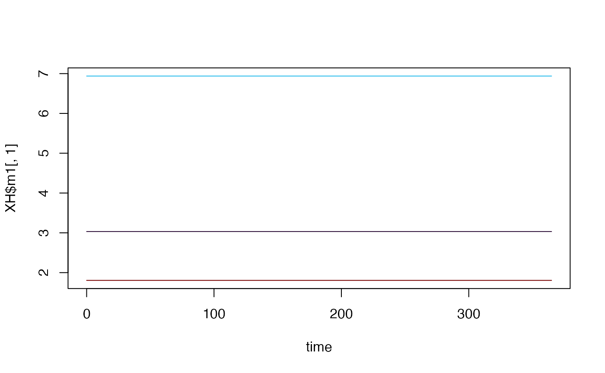

# Hybrid MoI (Multiplicity of Infection) Human Model

This is a hybrid model which tracks the mean multiplicity of infection
(superinfection) in two compartments. The first, \\(m1\\) is all
infections, and the second \\(m2\\) are apparent (patent) infections.
Therefore \\(m2\\) is “nested” within \\(m1\\). It is a “hybrid” model
in the sense of [Nåsell
(1985)](https://link.springer.com/book/10.1007/978-3-662-01609-1).

## Differential Equations

The equations are as follows:

\\\[\dot{m\_{1}} = h - r\_{1}m\_{1}\\\] \\\[\dot{m\_{2}} = h -
r\_{2}m\_{2}\\\] Where \\(h = b EIR\\), is the force of infection.
Prevalence can be calculated from these MoI values by:

\\\[x\_{1} = 1-e^{-m\_{1}}\\\] \\\[x\_{2} = 1-e^{-m\_{2}}\\\] The net
infectious probability to mosquitoes is therefore given by:

\\\[x = c\_{2}x\_{2} + c\_{1}(x\_{1}-x\_{2})\\\]

Where \\(c\_{1}\\) is the infectiousness of inapparent infections, and
\\(c\_{2}\\) is the infectiousness of patent infections.

## Equilibrium solutions

One way to proceed is assume that \\(m\_{2}\\) is known, as it models
the MoI of patent (observable) infections. Then we have:

\\\[h = r\_{2}/m\_{2}\\\] \\\[m\_{1} = h/r\_{1}\\\] We can use this to
calculate the net infectious probability, and then \\(\kappa =
\beta^{\top} \cdot x\\), allowing the equilibrium solutions of this
model to feed into the other components.

## Example

\
[`library`](https://rdrr.io/r/base/library.html)`(`[`ramp.xds`](https://dd-harp.github.io/ramp.xds/)`)`\
[`library`](https://rdrr.io/r/base/library.html)`(`[`deSolve`](https://github.com/tpetzoldt/deSolve/)`)`\
[`library`](https://rdrr.io/r/base/library.html)`(`[`viridisLite`](https://sjmgarnier.github.io/viridisLite/)`)`

Here we run a simple example with 3 population strata at equilibrium. We
use `ramp.xds::make_parameters_X_hMoI_xde` to set up parameters. Please
note that this only runs the human population component and that most
users should read [our fully worked
example](https://dd-harp.github.io/ramp.xds/articles/ex_534.md) to run a
full simulation.

We use the null (constant) model of human demography (\\(H\\) constant
for all time). While \\(H\\) does not appear in the equations above, it
must be specified as the model of bloodfeeding (\\(\beta\\)) relies on
\\(H\\) to compute consistent values.

## The Long Way

Here, we build a model step-by-step.

\
`nStrata`` ``<-`` ``3`\
`H`` ``<-`` `[`c`](https://rdrr.io/r/base/c.html)`(``100``, ``500``, ``250``)`\
`residence`` ``=`` `[`rep`](https://rdrr.io/r/base/rep.html)`(``1``,``3``)`` `\
`xds_obj`` ``<-`` `[`make_xds_object_template`](https://dd-harp.github.io/ramp.xds/reference/make_xds_object_template.md)`(``"ode"``, ``"eir"``, ``1``, ``0``, ``residence``)`

\
`b`` ``<-`` ``0.55`\
`c1`` ``<-`` ``0.05`\
`c2`` ``<-`` ``0.25`\
`r1`` ``<-`` ``1``/``250`\
`r2`` ``<-`` ``1``/``50`

\
`m2`` ``<-`` `[`rlnorm`](https://rdrr.io/r/stats/Lognormal.html)`(``3``, ``.2``, ``.5``)`` `\
`h`` ``<-`` ``r2``*``m2`\
`m1`` ``<-`` ``h``/``r1`\
`Xo`` ``=`` `[`list`](https://rdrr.io/r/base/list.html)`(``b ``=`` ``b``, c1 ``=`` ``c1``, c2 ``=`` ``c2``, r1 ``=`` ``r1``, r2 ``=`` ``r2``, m1``=``m1``, m2``=``m2``, H``=``H``)`

\
`eir`` ``<-`` ``h``/``b`

\
`xds_obj`` ``=`` `[`setup_XH_obj`](https://dd-harp.github.io/ramp.xds/reference/setup_XH_obj.md)`(``"hMoI"``, ``residence``, ``xds_obj``, ``1``, ``Xo``)`

\
`xds_obj`` ``=`` `[`setup_MY_obj`](https://dd-harp.github.io/ramp.xds/reference/setup_MY_obj.md)`(``"trivial"``, ``xds_obj``, ``1``)`\
`xds_obj`` ``=`` `[`setup_L_obj`](https://dd-harp.github.io/ramp.xds/reference/setup_L_obj.md)`(``"trivial"``, ``1``, ``xds_obj``, ``1``)`

\
`F_season`` ``=`` ``F_one`\
`F_trend`` ``=`` ``F_one`\
`F_shock`` ``=`` ``F_one`

\
`xds_obj``$``EIR_obj`` ``=`` `[`list`](https://rdrr.io/r/base/list.html)`(``)`` `\
`xds_obj``$``EIR_obj``$``eir`` ``<-`` `[`as.vector`](https://rdrr.io/r/base/vector.html)`(``eir``)`\
`xds_obj``$``EIR_obj``$``scale`` ``<-`` ``1`` `\
`xds_obj``$``EIR_obj``$``F_season`` ``<-`` ``F_season`\
`xds_obj``$``EIR_obj``$``F_trend`` ``<-`` ``F_trend`\
`xds_obj``$``EIR_obj``$``F_shock`` ``<-`` ``F_shock`

\
`xds_obj``$``EIR_obj``$``F_age`` ``<-`` ``F_one`\
`xds_obj``$``EIR_obj``$``season_par`` ``<-`` `[`list`](https://rdrr.io/r/base/list.html)`(``)`` `\
`xds_obj``$``EIR_obj``$``trend_par``<-`` `[`list`](https://rdrr.io/r/base/list.html)`(``)`` `\
`xds_obj``$``EIR_obj``$``shock_par``<-`` `[`list`](https://rdrr.io/r/base/list.html)`(``)`` `\
`xds_obj``$``EIR_obj``$``age_par``<-`` `[`list`](https://rdrr.io/r/base/list.html)`(``)`` `\
`xds_obj``$``EIR_obj``$``bday`` ``<-``0`

\
`xds_obj`` ``=`` `[`make_indices`](https://dd-harp.github.io/ramp.xds/reference/make_indices.md)`(``xds_obj``)`

\
`y0`` ``<-`` `[`get_inits`](https://dd-harp.github.io/ramp.xds/reference/get_inits.md)`(``xds_obj``)`\
`y0`\
`#> $L`\
`#> list()`\
`#> `\
`#> $MY`\
`#> NULL`\
`#> `\
`#> $X`\
`#> $X$m1`\
`#> [1] 3.032587 6.938575 1.805443`\
`#> `\
`#> $X$m2`\
`#> [1] 0.6065175 1.3877150 0.3610886`\
`#> `\
`#> `\
`#> $V`\
`#> NULL`

\
`xds_obj`` ``<-`` `[`xds_solve`](https://dd-harp.github.io/ramp.xds/reference/xds_solve.md)`(``xds_obj``)`` `\
`XH`` ``<-`` ``xds_obj``$``outputs``$``orbits``$``XH``[[``1``]``]`\
`time`` ``<-`` ``xds_obj``$``outputs``$``time`

\
`clrs`` ``=`` `[`turbo`](https://sjmgarnier.github.io/viridisLite/reference/viridis.html)`(``5``)`\
[`plot`](https://rdrr.io/r/graphics/plot.default.html)`(``time``, ``XH``$``m1``[``,``1``]``, col ``=`` ``clrs``[``1``]``, ylim ``=`` `[`range`](https://rdrr.io/r/base/range.html)`(``XH``$``m1``)``, type ``=`` ``"l"``)`\
[`lines`](https://rdrr.io/r/graphics/lines.html)`(``time``, ``XH``$``m1``[``,``2``]``, col ``=`` ``clrs``[``2``]``)`\
[`lines`](https://rdrr.io/r/graphics/lines.html)`(``time``, ``XH``$``m1``[``,``3``]``, col ``=``clrs``[``5``]``)`\
`  `\
[`lines`](https://rdrr.io/r/graphics/lines.html)`(``time``, ``XH``$``m2``[``,``1``]``, col ``=`` ``clrs``[``1``]``, lty ``=`` ``2``)`\
[`lines`](https://rdrr.io/r/graphics/lines.html)`(``time``, ``XH``$``m2``[``,``2``]``, col ``=`` ``clrs``[``2``]``, lty``=``2``)`\
[`lines`](https://rdrr.io/r/graphics/lines.html)`(``time``, ``XH``$``m2``[``,``3``]``, col ``=``clrs``[``5``]``, lty``=``2``)`

## Using Setup

\
[`xds_setup_eir`](https://dd-harp.github.io/ramp.xds/reference/xds_setup_eir.md)`(``eir``, Xname``=``"hMoI"``, HPop``=``H``, XHoptions ``=`` ``Xo``)`` ``->``test_hMoI`

\
[`xds_solve`](https://dd-harp.github.io/ramp.xds/reference/xds_solve.md)`(``test_hMoI``)``->`` ``test_hMoI`` `\
`XH2`` ``<-`` ``test_hMoI``$``outputs``$``orbits``$``XH``[[``1``]``]`\
[`sum`](https://rdrr.io/r/base/sum.html)`(``(``XH``$``m1``-``XH2``$``m1``)``^``2``)`\
`#> [1] 5198.155`
