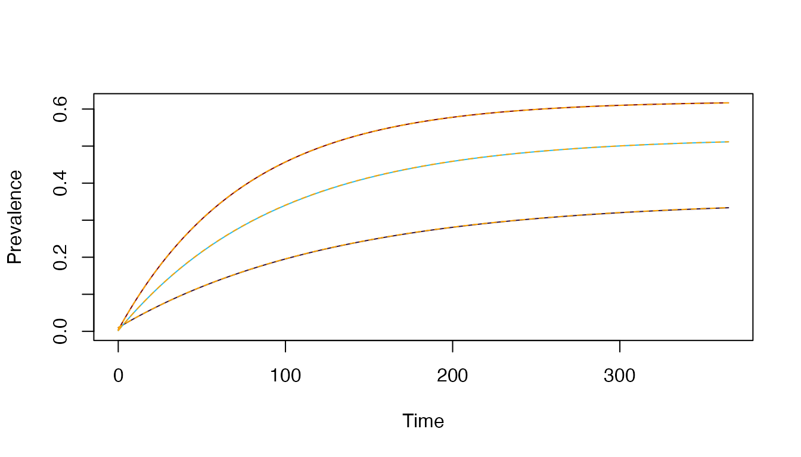
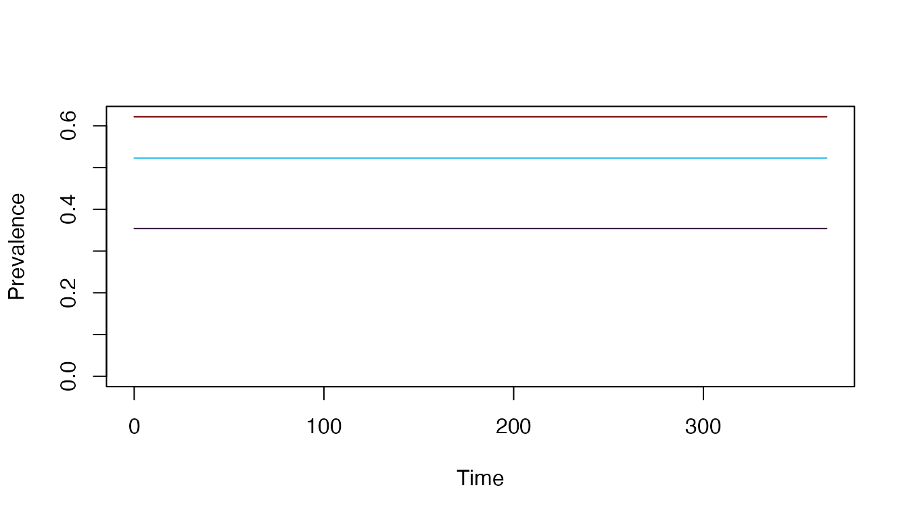
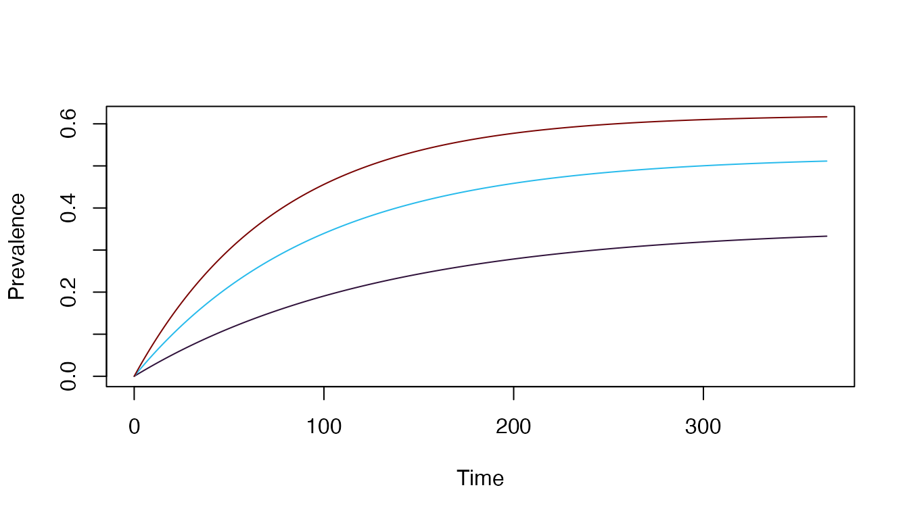

# The SIS Module

    XHname = "SIS"

------------------------------------------------------------------------

**Figure 1**: A Diagram of the SIS Model. For a more mathematical
introduction, see [**Malaria Theory** – SIS
Dynamics](https://faculty.washington.edu/smitdave/malaria_theory/sis.html)

------------------------------------------------------------------------

## Overview

For the **XH** component, the `SIS` module implements a generalized
version of the *S-I-S* compartmental model both

1.  as a system of ordinary differential equations; and

\
[`library`](https://rdrr.io/r/base/library.html)`(`[`ramp.xds`](https://dd-harp.github.io/ramp.xds/)`)`\
`ode_mod`` ``<-`` `[`xds_setup`](https://dd-harp.github.io/ramp.xds/reference/xds_setup.md)`(``XHname ``=`` ``"SIS"``)`` `

2.  as a discrete time system.

\
`dts_mod`` ``<-`` `[`xds_setup`](https://dd-harp.github.io/ramp.xds/reference/xds_setup.md)`(``XHname ``=`` ``"SIS"``, xds``=`` ``"dts"``)`` `

This vignette describes the basic model and its generalized
implementation in **`ramp.xds.`**

### The Basic S-I-S model

In the S-I-S model, individuals are either infected and infectious
\\((I)\\) or uninfected and susceptible to infection \\((S)\\), and the
total population sizes is \\(H=S+I.\\)

The rate that susceptible individuals become infected is called the
*force of infection* (or FoI, Ross called it the *happenings* rate,
denoted \\(h\\)). The rate of clearance is \\(r.\\) After clearing an
infection, individuals are susceptible to infection again. In its
simplest form.

\\\[\begin{array}{rl} \frac{dS}{dt} &= - h S + r I \\\\ \frac{dI}{dt} &=
h S - r I \\\\ \end{array}\\\] For this system, note that
\\\[\frac{dS}{dt} = - \frac{dI}{dt}\\\] and since \\(H=S+I,\\) we can
compute \\\[\frac{dH}{dt} = \frac{dS}{dt} + \frac{dI}{dt} = 0.\\\] In
this case, \\(H\\) is a parameter, and we don’t need to compute both
variables. We could simply compute:

\\\[\frac{dI}{dt} = h (H-I) - r I\\\]

This is the system that is implemented for the *default* parameter
settings.

### Demographic Change

In **`ramp.xds`** we implement a generalized approach to the demographic
processes: the system includes births \\(B\\) and deaths (in this case,
at the per-capita rate \\(\mu\\)), now \\(H\\) is a variable, and we can
write out full dynamical system for all three variables. We write it to
emphasize the two parts: disease dynamics (**X**) and human population
dynamics (**H**):

\\\[\begin{array}{rcc} & \mathbf{X} & \mathbf{H} \\\\ \hline
\frac{dH}{dt} =& & B(t,H) - \mu H \\\\ \frac{dS}{dt} =& - h S + r I & +
B(t,H) - \mu S \\\\ \frac{dI}{dt} =& h S - r I &- \mu I \\\\
\end{array}\\\] Since \\(H=S+I,\\) one of these equations is redundant.
To implement *progressive stratification,* we drop \\(S,\\) and use a
function \\(\mathbf{D}\\) that computes deaths for some variable in a
consistent way:

\\\[\begin{array}{rcr} \frac{dH}{dt} =& &B(t,H) - \mathbf{D}(t,H)\\\\
\frac{dI}{dt} =& h (H-I) - r I &- \mathbf{D}(t,I)\\\\ \end{array}\\\]
After solving, we compute \\(S=H+I\\) and attach its orbit. By default,
birth rates and death rates are set to zero, a constant population
model, equivalent to the basis S-I-S model. The birth and death
functions are modified using:

- [setup_births](https://dd-harp.github.io/ramp.xds/reference/setup_births.html)

- [setup_deaths](https://dd-harp.github.io/ramp.xds/reference/setup_deaths.html)

### Treatment

In the S-I-S model, there is no chemoprotected state, so drug taking
simply clears infections. (In other models, a brief period of
chemo-protection follows treatment.) The module assumes that

- \\(\rho\\) or `rho`: a fraction \\(\rho\\) of incident infections are
  treated and cured, so the FoI is now \\(h (1-\rho).\\) Since exposure
  and infection could also occur in folks who are uninfected, infected
  individuals also clear at the additional rate \\(\rho h.\\)

- \\(\sigma\\) or `sigma`: treatment and curing also occurs for other
  reasons at the rate \\(\sigma.\\)

- \\(\Xi(t)\\): mass treatment is implemented either as mass drug
  administration (`mda(t)`) or mass screening and treating (`msat(t)`),
  a shock function \\(\Xi(t)\\)

- The total rate that infections clear is thus: \\\[r + \rho h +
  \sigma + \Xi(t)\\\]

By default, treatment probabilities and rates are set to zero, so it is
equivalent to the basis S-I-S model.

## Dynamics

### ODE

For the system of ordinary differential equations, the system is:

\\\[\begin{array}{rcc} & \mathbf{X} & \mathbf{H} \\\\ \hline
\frac{dH}{dt} =& &B(t,H) - \mathbf{D}(t,H)\\\\ \frac{dI}{dt} =& h
(1-\rho)(H-I) - \left(r + h\rho + \sigma + \Xi \left( t \right) \right)
I &- \mathbf{D}(t,I)\\\\ \end{array}\\\]

### DTS

In the discrete-time system, the demographic change for \\(I_t\\) is
computed in two steps: survival \\((I_s)\\) and then infection dynamics:

\\\[\begin{array}{rcc} & \mathbf{X} & \mathbf{H} \\\\ \hline H\_{t+1} =&
&B(t,H_t) - \mathbf{D}(t,H_t)\\\\ I_s =& & I_t - \mathbf{D}(t,I_t) \\\\
I\_{t+1} &= \alpha_t(1-\rho) (H\_{t+1} + I_s) + e^{-\left(r + h\rho +
\sigma + \Xi \left( t \right) \right)} I_s \\\\ \end{array}\\\]

## Exposure

The module handles exposure through the standard interface (see
[Exposure](https://dd-harp.github.io/ramp.xds/articles/Exposure.md)). In
a nutshell:

- \\(E(t)\\): the daily EIR is computed for each population stratum

- \\(b\\) is a basis prameter in the **SIS** module describing the
  probability of getting infected by an infectious bite

- \\(h\\) is the daily FoI, `foi` (or what Ross called the *happenings*
  rate):

  - it is computed in `Exposure` as \\(h = F_h(b, E)\\)

  - By default, the FoI assumes the number of bites per persion is
    Poisson, so the FoI is linearly proportional to the EIR: \\(h = b
    E\\)

For more, including advanced setup options, see
[Exposure](https://dd-harp.github.io/ramp.xds/articles/Exposure.html%5D)

## Infectiousness: \\(c\\)

Infected humans are not fully infectious. We assume that the fraction of
bloodmeals on infectious humans that infect a mosquito is \\(c.\\) The
blood feeding and transmission interface uses biting weights and
availability, so we compute the infectious density of a stratum: \\\[F_I
= c I.\\\]

If there is a single population stratum, then\
\\\[\kappa = \frac {cI} H\\\]

## Diagnostics and Detection

The probability a human would *test positive* is denoted \\(q\\), so
while true prevalence is \\\[x=I/H,\\\] observed prevalence would be
\\\[x_q=qI/H.\\\] The model includes three parameters for detection by
light microscopy, RDT or PCR:

- `q_lm` - the probability of detecting parasites by light microscopy

- `q_rdt` - the probability of detecting parasites by rapid diagnostic
  test

- `q_pcr` - the probability of detecting parasites by PCR

We note that in this model, the observed PR is a linear function of the
true PR.

## Basic Setup

### Variables

During basic setup, the defaults are

- `H=1000`

- `I=1`

### Parameters

During basic setup, the parameters are assigned the following default
values:

- `b=0.55`

- `r=1/180`

- `c=0.15`

- `rho=0`

- `sigma=0`

- `q_lm=0.8`

- `q_rdt=0.8`

- `q_pcr=0.9`

To inspect the parameters, use `get_XH_pars.` We already set up `mod`
using the default values:

\
[`get_XH_pars`](https://dd-harp.github.io/ramp.xds/reference/get_XH_pars.md)`(``ode_mod``)``$``r`

    ## [1] 0.005555556

To override the defaults at setup, pass a named list to `xds_setup.`

\
`mod1`` ``<-`` `[`xds_setup`](https://dd-harp.github.io/ramp.xds/reference/xds_setup.md)`(``XHname ``=`` ``"SIS"``, XHoptions ``=`` `[`list`](https://rdrr.io/r/base/list.html)`(``r``=``1``/``200``)``)`\
[`get_XH_pars`](https://dd-harp.github.io/ramp.xds/reference/get_XH_pars.md)`(``mod1``)``$``r`

    ## [1] 0.005

To change a parameter value after setup, pass a named list to
`change_XH_pars.`

\
`ode_mod`` ``<-`` `[`change_XH_pars`](https://dd-harp.github.io/ramp.xds/reference/change_XH_pars.md)`(``ode_mod``, options ``=`` `[`list`](https://rdrr.io/r/base/list.html)`(``r``=``1``/``100``)``)`\
[`get_XH_pars`](https://dd-harp.github.io/ramp.xds/reference/get_XH_pars.md)`(``ode_mod``)``$``r`

    ## [1] 0.01

------------------------------------------------------------------------

## Mass Treatment

The module includes a port to simulate mass treatment. In the SIS model,
mass treatment increases the clearance rate from \\(r\\) to \\(r +
\xi(t)\\). After curing an infection, in this model, the humans become
susceptible to infection again.

\\\[\dot{I} = h (H-I) - \left(r+\xi\left(t\right)\right) I\\\]

\\(\Xi(t)\\) includes both `mda(t)` and `msat(t)`: functions
implementing mass treatment

- The function `mda(t)` implements mass drug administration

- The function `msat(t)` implements mass screen and treat using
  detection parameters (see above)

During basic set up, the function returns no effect: `mda(t)=msat(t)=0`.
Configuring a mass treatment function is handled as an advanced setup
option in `ramp.control` (see [`ramp.control`::Mass
Treatment](https://dd-harp.github.io/ramp.control/articles/MassTreatment.html))

- \[ramp.forcing;:setup_mass_treatment)

## Example

Here we run a simple example with 3 population strata at equilibrium. We
use `ramp.xds::setup_XH` to set up parameters, and
[`ramp.xds::setup_XH_inits`](https://dd-harp.github.io/ramp.xds/reference/setup_XH_inits.md)
to set the initial values. We configure a `trace` function to force the
EIR.

Users interested in more technical details should read [our fully worked
multi-patch
example](https://dd-harp.github.io/ramp.xds/articles/ex_534.md).

First, we define the size of three population strata:

\
`H`` ``<-`` `[`c`](https://rdrr.io/r/base/c.html)`(``100``, ``500``, ``250``)`\
`nStrata`` ``<-`` `[`length`](https://rdrr.io/r/base/length.html)`(``H``)`` `

We use the use the default model of human demography with no births or
deaths.

Next, we define the parameter values for all three strata as a named
list:

\
`b`` ``<-`` `[`rep`](https://rdrr.io/r/base/rep.html)`(``0.55``, ``nStrata``)`` `\
`c`` ``<-`` `[`rep`](https://rdrr.io/r/base/rep.html)`(``0.15``, ``nStrata``)`` `\
`r`` ``<-`` `[`rep`](https://rdrr.io/r/base/rep.html)`(``1``/``200``, ``nStrata``)`

To use these values to build our model, we create a named list:

\
`Xo`` ``=`` `[`list`](https://rdrr.io/r/base/list.html)`(``b``=``b``, c``=``c``, r``=``r``)`

We want to set up the model in a way that tests the software. We want to
set values of the EIR and, knowing what the answer should be, show that
we get them back. First, we set the values of the FoI, and then we
compute the EIR:

\
`foi`` ``=`` `[`c`](https://rdrr.io/r/base/c.html)`(``1``:``3``)``/``365`` `\
`eir`` ``<-`` ``foi``/``b`` `

The equilibrium values we should get back after running the equations to
steady state are \\(I = H h /(h+r)\\)

\
`I_eq`` ``=`` ``H``*``foi``/``(``foi``+``r``)`` `\
`I_eq`

    ## [1]  35.39823 261.43791 155.44041

First, we use `xds_setup` and next, we do it the long way

## Using Setup

To set up the model, we simply do this:

\
[`xds_setup_eir`](https://dd-harp.github.io/ramp.xds/reference/xds_setup_eir.md)`(``eir``, XHname``=``"SIS"``, HPop``=``H``, XHoptions ``=`` ``Xo``)`` ``->`` ``test_SIS_ode`\
[`xds_setup_eir`](https://dd-harp.github.io/ramp.xds/reference/xds_setup_eir.md)`(``eir``, XHname``=``"SIS"``, HPop``=``H``, XHoptions ``=`` ``Xo``, xds``=``"dts"``)`` ``->`` ``test_SIS_dts`

To solve it, we do this:

\
[`xds_solve`](https://dd-harp.github.io/ramp.xds/reference/xds_solve.md)`(``test_SIS_ode``)``->`` ``test_SIS_ode`\
[`xds_solve`](https://dd-harp.github.io/ramp.xds/reference/xds_solve.md)`(``test_SIS_dts``)``->`` ``test_SIS_dts`

We plot the prevalence over time:

\
`clrs`` ``=`` ``viridisLite``::`[`turbo`](https://sjmgarnier.github.io/viridisLite/reference/viridis.html)`(``5``)``[`[`c`](https://rdrr.io/r/base/c.html)`(``1``,``2``,``5``)``]`\
[`xds_plot_PR`](https://dd-harp.github.io/ramp.xds/reference/xds_plot_PR.md)`(``test_SIS_ode``, clr``=``clrs``)`\
[`xds_plot_PR`](https://dd-harp.github.io/ramp.xds/reference/xds_plot_PR.md)`(``test_SIS_dts``, lty``=``2``, clrs ``=`` `[`rep`](https://rdrr.io/r/base/rep.html)`(``"orange"``, ``3``)``, add``=``T``)`

If we set the initial values of \\(I\\) to the steady state values, the
variables shouldn’t change at all. To change the values, we simply add
them to the list

\
`test_SIS`` ``<-`` `[`change_XH_inits`](https://dd-harp.github.io/ramp.xds/reference/change_XH_inits.md)`(``test_SIS_ode``, options ``=`` `[`list`](https://rdrr.io/r/base/list.html)`(``I``=``I_eq``)``)`\
[`xds_solve`](https://dd-harp.github.io/ramp.xds/reference/xds_solve.md)`(``test_SIS``)``->`` ``test_SIS`` `\
[`xds_plot_PR`](https://dd-harp.github.io/ramp.xds/reference/xds_plot_PR.md)`(``test_SIS``, clr``=``clrs``)`

Or we can use the `get_XH_orbits` function to get the values of the
orbits. This gets the return values and pulls of the the values of
\\(I\\) at the last time step:

\
[`get_XH_orbits`](https://dd-harp.github.io/ramp.xds/reference/get_XH_orbits.md)`(``test_SIS``, ``1``)`` ``->`` ``XH2`\
`I_last`` ``<-`` `[`tail`](https://rdrr.io/r/utils/head.html)`(``XH2``$``I``, ``1``)`\
`I_last`

    ##               4        5        6
    ## [366,] 35.39823 261.4379 155.4404

\
[`sum`](https://rdrr.io/r/base/sum.html)`(`[`tail`](https://rdrr.io/r/utils/head.html)`(``XH2``$``I``, ``1``)`` ``-`` ``I_eq``)`

    ## [1] 0

## Another Test

If we set \\(I(0) = 0\\), the simple model has a closed form solution:

\\\[I(t) = H (1-e^{-(h+r) t}) \frac{h}{h+r}\\\] We can reset the initial
conditions and solve the system of differential equations:

\
`test_SIS`` ``<-`` `[`change_XH_inits`](https://dd-harp.github.io/ramp.xds/reference/change_XH_inits.md)`(``test_SIS``, options ``=`` `[`list`](https://rdrr.io/r/base/list.html)`(``I``=`[`rep`](https://rdrr.io/r/base/rep.html)`(``0``,``3``)``)``)`\
[`xds_solve`](https://dd-harp.github.io/ramp.xds/reference/xds_solve.md)`(``test_SIS``)``->`` ``test_SIS`` `\
`Itest`` ``=`` `[`get_XH_orbits`](https://dd-harp.github.io/ramp.xds/reference/get_XH_orbits.md)`(``test_SIS``, ``1``)``$``I`` `\
[`xds_plot_PR`](https://dd-harp.github.io/ramp.xds/reference/xds_plot_PR.md)`(``test_SIS``, clr``=``clrs``)`

…and we can compute the exact solutions for the same values of \\(t\\):

\
`t`` ``=`` `[`get_XH_orbits`](https://dd-harp.github.io/ramp.xds/reference/get_XH_orbits.md)`(``test_SIS``, ``1``)``$``time`\
`It`` ``=`` `[`matrix`](https://rdrr.io/r/base/matrix.html)`(``0``, ``366``, ``3``)`\
`ss`` ``=`` ``H``*``foi``/``(``r``+``foi``)`\
`for``(``i`` ``in`` ``1``:``3``)``{`\
`  ``It``[``,``i``]`` ``=`` ``H``[``i``]``*``(``1``-`[`exp`](https://rdrr.io/r/base/Log.html)`(``-``(``r``[``i``]``+``foi``[``i``]``)``*``t``)``)``*``foi``[``i``]``/``(``foi``[``i``]``+``r``[``i``]``)`\
`}`

The summing over all the squared differences is less than \\(10^{-6}.\\)

\
[`sum`](https://rdrr.io/r/base/sum.html)`(``(``It``-``Itest``)``^``2``)`` ``<`` ``1e-6`

    ## [1] TRUE
