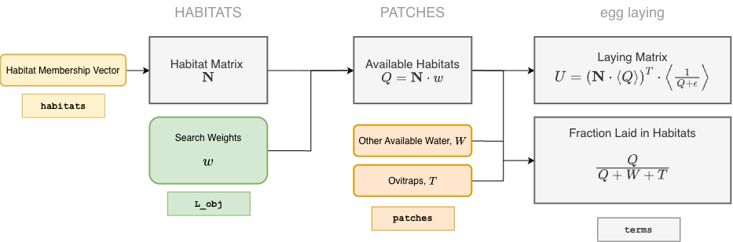

```{r, message=F}
require(ramp.xds)
```

{width=95%}


***

# The Habitat Matrix 

The **ML**-interface handles aquatic habitats, including egg laying by adult mosquitoes and emergence from aquatic habitats. During basic setup, the interface is configured by passing a habitat membership vector, which gives the index of the patch in which each habitat is found.

From the membership vector, the software creates and stores the *habitat matrix* $\mathbf N$: if the $i^{th}$ habitat is in the $j^{th}$ patch then the $i,j^{th}$ element of $\textbf{N}$ is 1, and otherwise it is zero.

For example: 

```{r}
membership <- c(1,1,1,2,2)
ramp.xds::make_habitat_matrix(3, membership) -> N
N
```
Sums are done as dot products: for example, 
emerging adults from the habitats ($\alpha$) are aggregated by patch and added to the adult mosquito population.
$$
    \Lambda = \mathbf{N} \cdot \alpha
$$
The **MY** component uses $\Lambda$ to model recruitment. 


# Searching

**Egg Laying** in aquatic habitats is assumed to the outcome of searching, and searching for aquatic habitats is something adult mosquitoes do in the patches. To model searching we introduce the habitat search weight $w,$ and then we compute habitat availability: 

+ $w$ --- finding a habitat while searching within a patch is modeled with search weights $w.$ 

    - By default, the search weights are all set to 1. 
    
    - Search weights can be changed using `setup_habitat_search_weights`.

+ $Q$ --- Availability of habitats, per patch, is a simple sum: $$Q = \mathbf{N}\cdot w$$ 

```{r}
weights = c(1,2,7,.5,2)
Q <- N%*% weights
Q
```

+ **Other Water** ($W$) --- The term *habitats* is synonymous with *productive habitats,* or any habitat that could potentially foster development of mosquitoes from egg, through all larval instars and into the pupal stage. A variable is set up to model the availability of other water where eggs are laid, *bad habitats,* which includes any water where eggs are laid that would not produce adults.

    - By default, available bad habitat is set to 0. 
    
    - Search weights can be changed using `setup_bad_habitats`.

+ **Ovitraps** ($O$) --- A variable `ovitraps` is also available to simulate traps that attract egg-laying mosquitoes. 

    - By default, no ovitraps are available. 
    
    - Search weights can be changed using `setup_ovitraps`.

+ The fraction of eggs laid in one of the habitats is the availability of habitats in as a fraction of total availability of all water is the availability of habitats plus bad habitats or ovitraps: $$\frac{\textstyle{Q}}{\textstyle{Q + T + O}}$$ 

+ $\nu$ --- the egg laying rate, the number of oviposition events, per adult mosquito,  is a function of all available habitats and the availability of other things that compete with aquatic habitats for adult mosquito attention while egg laying: $$\nu = F_\nu(Q+T+O)$$ 

+ $\sigma$ --- the patch emigration rate can be computed using habitat availability (and the availability of other resources a mosquito needs): $$\sigma = F_\sigma(Q+T+O)$$ 

We note that egg laying rates and patch emigration rates can be set up without using the concept of searching. 

## The Egg Laying Matrix

Having set up an interface to describe adult mosquito egg laying behaviors, we must now use it to distribute the eggs laid by adults in each patch among all the habitats. 

+ the fraction of eggs laid in the $j^{th}$ patch by adults that go into the $i^{th}$ habitat in that patch is $w_i/Q_j.$ These are found in the laying matrix. To avoid divide by zero errors, we add a very small $\epsilon$ when normalizing. Finally, we use $\left<w\right>$ to denote a diagonal matrix made from the vector $w$, and: 
$$U = \left(N \cdot \left<w\right>\right)^T \cdot \left<\frac 1 {Q+ \epsilon} \right>$$ 
```{r}
ramp.xds::make_U_matrix(weights, N, Q)
```


