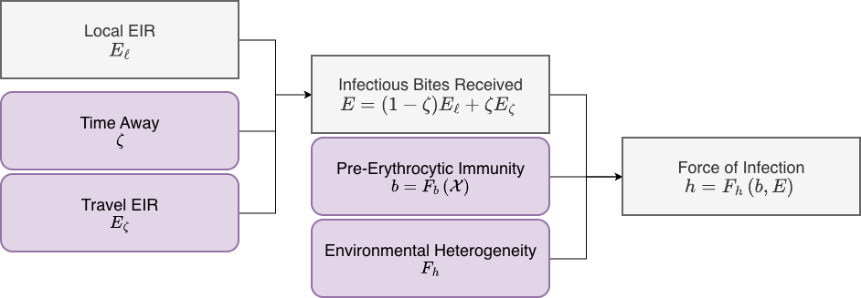

This vignette covers exposure in **`ramp.xds`** in two ways:

1. First, we give an overview of *heterogeneous exposure*

2. Next, we describe the `Exposure` interface in **`ramp.xds`**, which describes how heterogeneous exposure was implemented 

*** 

# Overview

The number of mosquito bites or blood meals per person is highly heterogeneous among individuals, a fact that is important for malaria transmission dynamics and control: 

1. Exposure includes local exposure and exposure while travel. 

2. Local exposure is heterogeneous because mosquito populations are heterogenously distributed among patches, and because people spend different amounts of time at risk because of where they live and where they go. These differences in exposure are handled through the *time spent* matrix, and the associated concept of *time at risk.*

3. There are important differences among individuals in exposure even after accounting for differences in time at risk. These have been attributed to factors such as age or body size; odors in breath or sweat that attract mosquitoes; and propensity to wear protective clothing. In **`ramp.xds`**, these differences are called *heterogeneous biting,* and they are modeled by assigning  *search weights* to different population strata. These search weights are one reason why there is heterogeneity in the expected number of infective bites per person in a stratified population. Heterogeneous biting is a kind of *frailty,* a multiplicative difference in the expected number of bites, per person, in some stratum.  

4. The expectation for a homogenous stratum could have a distribution. If, for example, the expected number of bites per person is *gamma* distributed, then the number of bites per person would follow a negative binomial distrbibution. In SimBA, this is called *environmental heterogeneity.* 

5. Exposure could be heterogeneous because of differences in the frequency of travel or the destinations. 

6. All else equal, individuals might be differentially susceptible to exposure because of immunity. 

*** 

# `Exposure`

+ In [`Transmission`](Transmission.html), the local EIR $(E_\ell)$ is computed and stored for every population stratum using using the search weights and time at risk.

+ In `Exposure`, the model comptues and stores the force of infection (FoI), the rate of infection by stratum (called $h$ or `foi`)

    + The local EIR is transformed into a measure of the total EIR using the concepts of *time away* $(\zeta)$ and *travel EIR* $(E_\zeta)$;  
      
    + The total EIR is modified by a function that computes the expected number of infections per infectious bite ($b$) using a function ($F_b$ or `F_infectivity`) from the **XH** component. In some modules, this quantity is a function of *pre-erythrocytic* immunity. 

        - By default, $F_b$ returns a constant $b$ 
    
        - Alternatives are defined in various **XH** modules

    + The FoI is computed from expected number of infectious bites $bE$ under a model of *environmental heterogeneity.*  The expected number of infective bites is $bE,$ but in each one of these homogenous strata, the expectation could have a distribution. For example, if the expectation has a *gamma* distribution, then the expected number of bites per person would follow a negative binomial distribution.

        - By default, $F_h$ returns $bE,$ consistent with a Poisson model of exposure. 
    
        - Alternative models pass the method name as the first argument to `setup_exposure` 

*** 

{width=100%}

